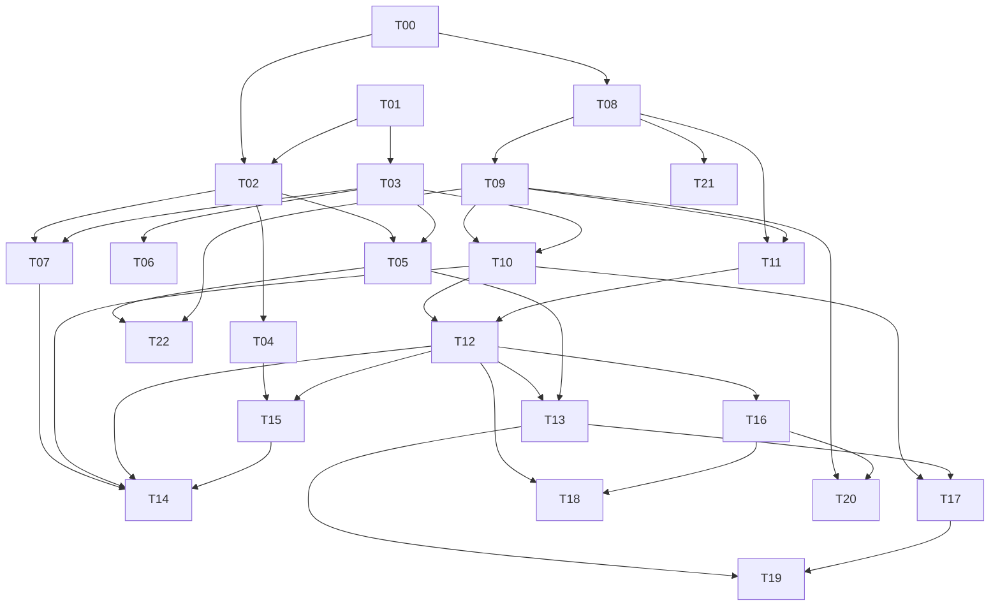

# ASTRO — plano de implementação e orquestração da sandbox visual

> **Escopo vigente desde 27/10/2026:** Portfolio v1, resumido abaixo, supersede a autorização anterior de execução integral. O restante é catálogo técnico/histórico; checkboxes abertos não bloqueiam v1. Preserve QA e evidências, sem reescrevê-los.

**Goal:** tornar o Sistema Solar uma sandbox pessoal visível e brincável, com duas ações de destaque confiáveis, sem buscar equivalência MLR.

**Architecture:** manter Core SI e Worker autoritativos; UI envia comandos revisionados e renderer apresenta snapshots aceitos. Enriquecer contratos somente quando uma entrega precisar deles. Introduzir modelos criativos nomeados e modelos científicos com domínio explícito, sem transformar efeitos artísticos em física implícita.

**Tech Stack:** Next 16.4.1, React 19.3.1, TypeScript, Three.js 0.186.1/WebGL2, Web Worker, Zod 4.6.7. Node `>=24.21.0 <25`, pnpm 12.11.2. Reconfirmar executáveis ao retomar.

**Spec:** [mapa completo, evidências e direção](../specs/2026-10-23-astro-sandbox-system-map.md). Ler os dois documentos; este plano deriva daquele mapa.

## Corte de escopo: Portfolio v1 (27/10/2026)

Jornada v1: abrir no Sistema Solar visível; selecionar/focar corpos, ajustar o tempo e pausar; usar **Impacto** ou **Buraco Negro**; depois resetar ou salvar/importar localmente. O Worker decide resultados; a interface identifica efeitos visuais.

Aceite objetivo: overview enquadra e permite selecionar 10 corpos; foco/retorno, zoom e pan funcionam. **Impacto** produz estado aceito pelo Worker, consequência visível e cratera persistente no save. **Buraco Negro** converte o Sol preservando ID/Rs, mostra horizonte legível e captura aceita com picking funcional. Pausa/reset, export/import local, layout desktop/mobile e console sem erros da aplicação também passam.

Fora do caminho feliz: laser, spin, impulso, SHARD, MIST, órbita avançada e anel/enxame; demais ampliações T14–T23, clima/geologia mais precisos e pincel. Lua/binário fica como bônus existente, fora do aceite. Preserve implementações.

Ordem restante: A) saúde/build; investigar `pendingSpinMutations` só se reproduzir após HMR quieto. B) correções visuais T06/T07. C) QA T13 de cratera/save. D) smoke desktop/mobile, pausa/reset e export/import local.

## Global Constraints

- A execução integral deste plano é histórica; somente Portfolio v1/Corte de escopo acima está ativo. Checkboxes antigos não bloqueiam v1.
- Não pedir novamente autorização para ações reversíveis já incluídas numa execução autorizada. Perguntar apenas por dados indispensáveis ou fronteira ainda não autorizada.
- Executar validação proporcional por entrega. Browser/servidor exigem confirmar dono e reutilizar sessão existente; não encerrar processo compartilhado.
- Preservar workspace e alterações locais; quase todo código está untracked. Sem limpeza, commit, push ou deploy automáticos.
- Sem mudança de provider/modelo, hooks globais ou configuração de plugins. Maestri CLI apenas se `MAESTRI_PIPE` existir; senão usar subagentes disponíveis.
- Um escritor por arquivo. Protocolos, `page.tsx`, `globals.css` e `celestial-scene.ts` exigem reservas explícitas.
- Worker decide corpos/tempo/modelo. Mutação e resultado precisam ser candidatos validados e commits atômicos.
- Física em SI. Sem truncar massa/material para obedecer cap64, sem modificar snapshot autoritativo no renderer.
- Saves v1–v7 continuam legíveis. v4 separa mundo/sessão; T10 acrescenta v5 para perfil térmico explícito; T11 acrescenta v6 para inventário de água explícito; T12 acrescenta v7 para composição material explícita. VFX não entram no save.
- Sem copiar código, marca, interface ou ativos do Universe Sandbox. Registrar licença/proveniência de novos ativos.
- Alvo: Chrome/Windows e Iris Xe; desktop 1280×720/1440×900, mobile 390×844/320×740.
- Respeitar teclado, leitor de tela, reduced motion, reset, importação e controle manual da câmera.
- Instalar dependência apenas quando solução existente/plataforma não resolver; conferir docs oficiais e guias locais Next antes de alterar APIs.

## Review Focus

1. ACK tardio, ERROR e reset/import durante ação: nunca selecionar/criar corpo fantasma ou reaplicar revisão antiga. T00/T08/T09.
2. Impactos simultâneos e cadeias: IDs podem desaparecer no mesmo intervalo; efeitos não exigem corpo ainda vivo. T02/T05/T07.
3. Zoom extremo, painel aberto e mudança de tipo com mesmo ID: câmera/picking seguem envelope atual sem voo repetido. T01/T02/T07.
4. Conservação e persistência: água/material/energia externa são ledgerados uma vez; legacy não ganha conteúdo silencioso. T10–T14/T18.
5. Falha de asset, contexto gráfico e queda de cadência: fallback preserva interação e resultado, sem canvas preto silencioso. T01/T03/T06.

## 1. Como outro coordenador deve retomar (somente Portfolio v1 ativo)

1. Leia `AGENTS.md`, `PRODUCT.md`, mapa associado, `docs/architecture.md`, `docs/design.md`, `docs/physics.md` e instruções de ferramentas pertinentes. Leia guias Next locais somente para APIs tocadas.
2. Verifique cwd/branch/HEAD/status e versões reais. Não inferir que arquivos atuais coincidem com este plano. Registre hashes apenas dos arquivos que a onda vai tocar.
3. Descubra agentes disponíveis. Distribua papéis abaixo; não suponha que nomes históricos representam terminais vivos.
4. Se houver execução autorizada, identifique runtime/porta/processo antes de usar. Reutilize Chrome existente com dono exclusivo. Não navegue para `example.com` como prova de browser.
5. Abra quadro de tarefas com IDs deste plano, dono, dependências e reserva de arquivos. Não despache o backlog inteiro.
6. Execute somente Portfolio v1/Corte de escopo acima. Despachos e sequências abaixo são recomendações históricas, sem autorização para ampliar o escopo.
7. Antes de cada onda, congele contrato necessário e exemplos válidos/inválidos. Depois libere escritores em escopos disjuntos.
8. Revise e integre antes do QA. Congele código durante captura para evitar HMR invalidar evidência.
9. Só marque tarefa concluída com sua demonstração e limitações registradas. Atualize docs responsáveis; não reescreva todo histórico.

### Papéis

| Papel | Responsabilidade | Arquivos reserváveis |
|---|---|---|
| Coordenador | produto, dependências, contratos, integração e arbitragem | quadro/plano, docs; protocolo apenas se escritor designado |
| Helion/Core | domínio, integrador, mutações, persistência, invariantes | `src/simulation/**`, docs física/arquitetura |
| Croma/renderer | cena, câmera, materiais, VFX, GPU | `src/features/simulation/{celestial-*,scene-*,camera-*,orbit-*,body-*,surface-*,rock-*}.ts` |
| Dial/UI | ferramentas, editor, menus, mobile/a11y | `page.tsx`, `globals.css`, componentes TSX; `SimulationCanvas.tsx` como ponte acordada |
| Prumo/QA | usuário comum, evidência Chrome e revisão independente | capturas/logs fora do checkout; specs somente em tarefa autorizada |

Nomes são funções, não requisito de ferramenta. Um agente pode assumir dois papéis sequencialmente; nunca dois escritores no mesmo arquivo.

### Padrão de handoff

```text
Task ID / estado / dependências:
Arquivos efetivamente alterados e reserva liberada:
Contrato consumido/produzido, exemplos e compatibilidade:
Resultado percebido pelo jogador:
Validação executada e evidências com horário/viewport/revisão:
Limitações/hipóteses restantes:
Runtime/Chrome: dono, URL, processo confirmado ou não:
Próxima tarefa liberada:
```

## 2. Ondas históricas (fora da execução ativa de Portfolio v1)

| Onda (catálogo histórico) | Entregas | Resultado jogável | Tamanho relativo |
|---|---|---|---|
| A — Base confiável | T00, T01, T02 | editar/selecionar sem surpresas; cena nunca some por asset | S/M |
| B — Espetáculo imediato | T03–T07 | impacto legível, céu/superfícies melhores, luzes e BH | M/L |
| C — Experimentar sem medo | T08, T09 | desfazer, checkpoints e biblioteca visual | M |
| D — Consequências acopladas | T10–T13 | estrelas aquecem mundos; água/atmosfera/terreno têm estado | L/XL |
| E — Ferramentas e eventos | T14–T19 | supernova criativa, anéis, spin, laser, meteoros e pincel | L/XL |
| F — Profundidade e autoria | T20–T22 | modelos adicionais validados, edição múltipla, captura/som | M/XL |
| Horizonte | T23 | pesquisas separadas sem bloquear o jogo | pesquisa |

S/M/L/XL indicam risco relativo, não horas prometidas. Cada tarefa pode exigir subtarefas após o contrato; não abrir um patch gigante por onda.



Após T00/T01, T02 e T03 podem avançar em paralelo **somente** se mudanças em `celestial-scene.ts` forem integradas pelo mesmo escritor. Módulos novos podem ser paralelos; ligação final na cena é sequencial. T08 pode avançar enquanto renderer trabalha, reservando Worker/protocolo/UI necessários. T10–T12 exigem extensões persistentes únicas; não criar versões incompatíveis ou campos concorrentes.

## 3. Contratos propostos para as entregas

São alvos de design, não APIs existentes ou congeladas nesta rodada. O executor confirma nomes com a fonte antes da primeira escrita. Não implementar todos antecipadamente.

### C1 — Identidade e geometria de apresentação, T02/T05

- Propor `provenance?: { kind: 'catalog' | 'duplicate' | 'collision-fragment' | 'manual-fragment'; sourceBodyIds: string[]; textureKey?: string }` no corpo persistente v4. `textureKey` deve ser enum/lista local, nunca URL arbitrária.
- Ausência mantém corpo legado normal. Migração pode reconhecer IDs canônicos; não classificar detrito só por substring de nome. Nome não determina física.
- VFX pode usar provenance em runtime antes do save v4; T02 só introduz o campo se puder mantê-lo na duplicação, parser e serialização. Caso contrário, manter índice runtime central e concluir persistência em T11.
- Adicionar `contact?: { pointM: Vector3; normal: Vector3 | null; relativeVelocityMs: Vector3 }` em evento collision. `positionM` mantém semântica anterior. Vetor normal nulo em geometria degenerada, sem fabricar direção.
- `pointM` é contato de esferas: calcular no estado resolvido e registrar limites para overlap inicial. Validar finitude, unidade/tolerância da normal e tipo de evento.

### C2 — Ferramentas transacionais, T04/T08/T17/T21

- Preview e previsão carregam `baseWorldRevision` e `requestId`; resultado velho é descartado.
- Propor `APPLY_IMPULSE {bodyId, impulseNs: Vector3}`: `v' = v + J/m`, energia externa é diferença cinética calculada; candidato inteiro valida.
- Propor `RESTORE_CHECKPOINT {checkpointId}` no protocolo interno do Worker. Não usar `SET_BODIES` stale da UI para undo.
- Propor mutação batch para edição múltipla somente em T21: lista bounded de ações permitidas, uma revisão, valida tudo ou rejeita tudo. Não aceitar recursão ou comandos arbitrários.
- Teclado pode informar posição/velocidade exatas; clique e arrasto continuam caminho principal.

### C3 — Estado persistente v4 e extensões versionadas, T09–T13/T16

Projetar um codec compartilhado e extensões opcionais; não gravar todos os campos de roadmap vazios. Forma mínima proposta:

```ts
type BodyModelState = {
  profileId?: string; // enum/versionado de perfis implementados
  provenance?: BodyProvenance;
  thermal?: { modelId: string; internalEnergyJ: number; albedo: number; emissivity: number };
  materials?: { modelId: "material-composition-v1"; rockKg: number; ironKg: number; gasKg: number };
  waterInventory?: { modelId: "water-inventory-v1"; dryMassKg: number; dryVolumeM3: number; liquidKg: number; iceKg: number; vaporKg: number; escapedKg: number };
  atmosphere?: { modelId: "isothermal-atmosphere-v1"; profileId: "nitrogen-oxygen-v1" | "carbon-dioxide-v1"; dryGasMassKg: number; isothermalTemperatureK: number };
  spin?: { angularVelocityRadS: Vector3; axisEpochSeconds: number };
  surface?: { modelId: string; seed: number; resolution: number; dataId: string };
};
```

Os nomes ilustram a fronteira. Cada `modelId` deve virar literal/enum fechado na entrega, não string livre em parser. T11 `waterInventory` é a única fonte persistida de água; a view pública de materiais deriva `waterKg = liquidKg + iceKg + vaporKg` quando o inventário existe, senão zero. Não persistir água duplicada em `materials`; `escapedKg` fica fora da massa retida.

T12 atmosfera persiste somente modelo/perfil isotérmico fechado, massa seca de gás e temperatura. `pressure`, `scaleHeight`, densidade e métricas ópticas são derivados; vapor fica só em T11 e pode compor a coluna sem duplicar massa. Massa atmosférica seca contribui à massa gravitante e a `waterInventory.dryMassKg`, não ao volume/raio sólido. O modelo declara gás ideal, mistura uniforme, casca fina e gravidade constante; exige gravidade positiva e `H/radius ≤ 0,05`. Opacidade e greenhouse do perfil são proxies diagnósticos, não valores espectrais nem aquecimento T10.

O codec distingue arquivo de mundo de checkpoint de sessão. Mundo contém corpos/settings/modelos; sessão opcional contém tempo/modo/velocidade/seleção/câmera. Eventos/VFX ativos não são reexecutados no load. T09 entrega v4; T10 adiciona v5 somente quando há `thermalProfileId`; T11 adiciona v6 quando há `waterInventory`; T12 usa v7 para composição explícita e atmosfera opcional de corpo materializado. v1–v6 permanecem legíveis sem migração implícita; v7 antigo sem atmosfera continua aceito. Cada `modelId` permanece literal fechado.

### C4 — Energia, material e resolução de superfície

- Só T10 altera temperatura por fluxo; antes disso emissão quente é artística.
- Acoplamento usa segundos realmente aceitos, não tempo solicitado descartado por orçamento.
- Impacto/laser não podem converter `energyJ` inteiro em calor implicitamente. Perfil define frações e ledger `external / translational / thermal / unresolved` sem contagem dupla.
- Superfície proposta: grade esférica bounded, começo 64×32 por corpo ativo, render interpola. Dados grandes não trafegam em todo snapshot.
- Usar revisão de superfície, patches bounded e chave de dados; save restaura o estado. Decidir armazenamento antes de T13, respeitando 10 MiB ou adotando novo container explícito.
- `dataId` referencia payload dentro do próprio arquivo/container exportado; nunca depender de cache local que outro computador não terá. Orçar no máximo 4 MiB para todas as superfícies no primeiro codec; rejeitar export acima do limite sem sobrescrever arquivo anterior. Preferir campos quantizados/compactos a arrays numéricos JSON extensos.
- Uma grade de elevação ilustrativa não altera raio de colisão até existir contrato específico. Informar esse limite na documentação, não em toast constante.

### C5 — Qualidade e efeitos

- `RenderQuality = 'auto' | 'low' | 'medium' | 'high'` é preferência visual, nunca física.
- Perfil controla DPR, textura, partículas, luzes e pós-processamento. Degradar decoração antes de legibilidade/picking.
- Efeito deriva de evento aceito e respeita geração/dedupe/expiry/reduced motion. Mais brilho não deve significar maior região clicável física.
- Separar hit proxy visual de raio físico. Clicar em disco/anel seleciona dono; colisão continua raio SI.

## 4. Entregas executáveis

### Resolução exata dos caminhos usados nas tarefas

Todos os caminhos são relativos à raiz do checkout. Para evitar repetir prefixos em cada lista, os nomes abaixo resolvem assim:

| Nomes citados | Diretório exato |
|---|---|
| `page.tsx`, `globals.css` | `src/app/` |
| `types.ts`, `physics.ts`, `physical-constants.ts`, `integrator.ts`, `simulation-time.ts`, `simulation.worker.ts`, `simulation-client.ts`, `collisions.ts`, `body-edits.ts`, `body-catalog.ts`, `world-mutations.ts`, `save-file.ts`, `surface-phase.ts`, `binary-star.ts`, `orbital-analysis.ts` | `src/simulation/` |
| `stellar-main-sequence.ts`, `stellar-evolution*.ts`, `solar-track-v1.json` | `src/simulation/` |
| `ObjectInspector.tsx`, `SimulationCanvas.tsx`, `SimulationToolbar.tsx`, `SimulationExperimentsDock.tsx`, `BodyCatalog.tsx`, `SaveControls.tsx`, `SolarEvolutionControls.tsx`, `OrbitalReadout.tsx` | `src/features/simulation/` |
| `celestial-scene.ts`, `celestial-bodies.ts`, `celestial-environment.ts`, `camera-focus.ts`, `scene-scale.ts`, `scene-placement.ts`, `scene-labels.ts`, `scene-events.ts`, `scene-effect-scale.ts`, `black-hole-capture-effect.ts`, `orbit-paths.ts`, `orbit-trails.ts`, `body-appearance.ts`, `body-texture.ts`, `surface-material.ts`, `rock-assets.ts`, `simulation-events.ts` | `src/features/simulation/` |
| Novos cálculos/modelos: `trajectory-preview.ts`, `world-history.ts`, `experiment-presets.ts`, `thermal-model.ts`, `water-model.ts`, `material-profiles.ts`, `atmosphere-model.ts`, `surface-state.ts`, `surface-patches.ts`, `creative-supernova.ts`, `orbital-placement.ts`, `swarm-model.ts`, `spin-model.ts`, `laser-model.ts`, `atmospheric-drag.ts`, `tidal-model.ts` | Criar em `src/simulation/`, somente na tarefa consumidora |
| Novos módulos gráficos: `render-quality.ts`, `scene-lighting.ts`, `interaction-tools.ts`, `scene-capture.ts`, `scene-audio.ts` | Criar em `src/features/simulation/`, somente se houver responsabilidade usada |

As extensões opcionais não justificam criar arquivos vazios antes da entrega. Para verificações futuras autorizadas, reutilizar `<nome>.test.ts` junto do módulo; E2E existente fica em `e2e/simulation.spec.ts`, `e2e/safe-scene-viewport.spec.ts`, `e2e/orbit-render-effects.spec.ts`, `e2e/solar-track-visual.spec.ts` e `e2e/solar-evolution.spec.ts`. Não colocar toda nova jornada no mesmo spec se isso criar disputa entre escritores.

### T00 — Integridade e experiência-base

**Dono:** Core para invariantes; Dial para ACK/editor; coordenador integra. **Depende:** nenhuma. **Prioridade:** P0.

**Arquivos:** `collisions.ts`, `body-edits.ts`, `simulation-client.ts`, `simulation.worker.ts`, `page.tsx`, `ObjectInspector.tsx`, `globals.css`; `PRODUCT.md`, `docs/{architecture,design,physics,setup,quality}.md` apenas trechos responsáveis.

- [x] Reproduzir/confirmar na fonte herança MIST após merge; remover metadata incompatível em qualquer resultado que saia da trilha. Não alterar trilha secular válida silenciosamente.
- [x] Definir canonicalização BH: temperatura zero e água não aplicável; API rejeita edits incompatíveis, mesmo se UI esconder controles. Massa continua recalculando Rs.
- [x] Manter draft de campo até ACK ou rejeição daquela revisão; indicador curto Aplicando sem substituir valor por snapshot antigo. Descartar draft no reset/import/troca de alvo.
- [x] Inicialização distingue preparando/pronto/erro; alvo de toque principal ≥44×44 CSS px sem reduzir safe scene.
- [x] Reconciliar docs contraditórias com fonte. Separar histórico de estado atual, sem apagar evidência histórica.
- [x] Aceite Chrome 23/10: Worker lento/rejeição/reset durante edição não criam estado falso; BH e merge salvam dados coerentes; entrada é overview Solar.

**Prova futura:** casos focados `body-edits`, `collisions`, Worker e Chrome editor com ACK atrasado. Não declarar testes antigos como prova nova.

### T01 — Cena resiliente e orçamento visual

**Dono:** Croma. **Depende:** nenhuma; integra com T00. **Prioridade:** P0.

**Arquivos:** `celestial-scene.ts`, `celestial-environment.ts`, `rock-assets.ts`, `SimulationCanvas.tsx`; criar `render-quality.ts` somente se concentrar política realmente usada.

- [x] Fallback `SphereGeometry` UV quando GLB principal falhar; compartilhar/destruir uma vez. Falha de textura usa fallback existente.
  - [x] Perfil C5 reage a viewport/DPR/capacidades/cadência; evita alternância constante com histerese e limites documentados.
  - [x] Medir RAF p50/p95, draw calls, triângulos e contagem de recursos. GPU somente se timer válido/disjoint tratado; não chamar RAF de GPU.
  - [x] Reduzir render em pausa estática; animação/voo/VFX/input continuam invalidando. Aba oculta não acumula backlog.
- [x] Bloquear GLB/mapas mantém corpos e canvas; fallback preserva a cena, embora alguns materiais fiquem escuros.
- [x] Resize 320×740 e 390×844 mantém canvas no viewport e separa dock, navegação, inspetor e transporte; sem sobreposição após ajustar reserva móvel.
- [x] 10/32/64 corpos foram criados/selecionados no Chrome. No cap 64, o catálogo informa o limite e não cria o 65º.

**Meta inicial, não promessa:** em Iris Xe/1280×720, mirar p95 de intervalo RAF ≤33,4 ms no cenário definido; registrar stutters e hardware. Se não couber, baixar qualidade; não mudar física sem task própria.

**Recheck Chrome — 23/10/2026:** a fonte liga `resetEpoch` à chave de `SimulationCanvas`; cada Reset remonta a cena. Cleanup agora chama `renderer.forceContextLoss()` depois de `dispose()`. Em oito resets seguidos, cada GL antigo reportou perdido; canvas único novo ficou ativo, `gl.getError()=0`, 10 corpos e nenhum erro/aviso novo. O aviso anterior de limite WebGL não reapareceu. Reload normal carregou 29 assets/modelos com HTTP 200. Com todas as texturas e o GLB principal interceptados em 503, canvas e 10 corpos permaneceram, sem alerta; fallback deixou alguns mundos escuros. Os erros de console nesse caso eram as respostas 503 injetadas. Log histórico de HMR contém rajadas 503/404, sem log de servidor que confirme origem.

**T01 ainda aberto — Chrome 23/10/2026, 3138:** criação via UI chegou a 32 e 64 corpos. Em 64, seleção/editor e canvas continuaram ativos; a tentativa de criar o 65º exibiu `Limite de 64 astros atingido.` sem exceder a contagem. Captura: `%TEMP%\astro-t01-64-body-overview-20261023.png`. Canvas único, WebGL ativo e `gl.getError()=0`; console sem erros/avisos. Reset restaurou Solar, 10 corpos, pausa e placement desligado. Resize com inspetor aberto foi conferido em 320×740 e 390×844; canvas backing acompanhou CSS, controles não se sobrepuseram. Gaps inspetor→transporte: 7,6 px e 8,4 px. Correção em `globals.css` reserva ao menos 84 px para rodapé e gap.

**Medição visual corrente — 10 corpos:** Chrome 155, 1280×720 CSS, DPR 1, 1 dia/s, órbitas ligadas. 600 intervalos RAF em ~10,08 s: p50 16,7 ms, p95 16,9 ms, máximo 33,5 ms (1 intervalo >33,4 ms). Telemetria interna em janela ativa, 60 amostras: p50 16,6 ms, p95 16,9 ms, 27 draw calls, 71.694 triângulos, 14 geometrias, 26 texturas, pixel ratio 1. Os números medem cadência/contadores do renderer, não tempo GPU. p95/contadores correntes em 32 e 64 corpos e timer GPU continuam sem medição; não declarar performance aprovada. Capturas mobile: `%TEMP%\astro-t01-resize-320-after-fix-20261023.png` e `%TEMP%\astro-t01-resize-390-after-fix-20261023.png`. Fallback sem mapas ainda escurece alguns materiais; origem das respostas 503/404 históricas segue sem confirmação.

### T02 — Seleção, labels e proveniência confiáveis

**Dono:** Croma; Core reserva C1 quando necessário. **Depende:** T00/T01.

**Arquivos:** `celestial-scene.ts`, `celestial-bodies.ts`, `scene-labels.ts`, `simulation-events.ts`, `page.tsx`; `types.ts`, parser/codec somente sob dono Core.

- [x] Hit proxies de anel/disco com dono/bodyId e ordenação por profundidade; respeitar oclusão.
- [x] Corrigir label ativo sem vaga: coordenadas/fallback explícitos; nunca deixar posição anterior flutuante.
- [x] Centralizar identidade visual e detrito por IDs de eventos aceitos; nomes não classificam corpos, preparando C1 sem regex de nome.
- [x] Não mostrar nomes de fragmentos em navegação/órbitas/labels por padrão. Selecionado pode ter indicação curta e aria completo.
- [x] Aceite: clicar anel Saturno/disco BH seleciona dono; selecionar astro já enquadrado não voa; renomear detrito não polui lista; teclado mantém foco. Chrome isolado confirmou os dois hit proxies; regressões focadas cobrem ID após rename e fallback com teclado.

### T03 — Luz, exposição e brilho natural

**Dono:** Croma. **Depende:** T01; ligação de cena serializada com T02.

**Arquivos:** `celestial-scene.ts`, `body-appearance.ts`, `celestial-bodies.ts`, `scene-events.ts`; módulo `scene-lighting.ts` se necessário.

- [x] Selecionar até duas luzes estelares relevantes no perfil baixo/médio e até quatro no alto; posições/cores/luminosidade derivadas do estado aceito.
- [x] Iluminação visual normalizada e limitada, separada do fluxo térmico SI futuro. Especificar curva para não confundir unidade de luz Three.js com watts.
- [x] Oclusão/eclipses aproximados e sombra do anel sem shadow map caro obrigatório; fill de inspeção não elimina lado noturno.
- [x] Flare desaparece por oclusão e ângulo; exposição varia suavemente, com limite; bloom seletivo só se medição justificar.
- [x] Luz curta de impacto tem teto e dissolve sem lavar textura. Reduced motion evita flicker.
- [x] Aceite: binária ilumina dos dois lados; eclipse escurece o planeta; Sol texturizado e rochas legíveis antes/durante/depois de evento.

**Aceite visual Chrome isolado — 24/10/2026:** Playwright CLI, HeadlessChrome 155, viewport/canvas 1036×703 CSS, DPR 1, renderer ANGLE Intel Iris Xe/D3D11. Binária pausada em revisão 7/1.384.007,04 s, com `binary-star-a`, `binary-star-b` e `rocky-planet-1`. Nos mesmos câmera/alvo/exposure 0,945, A-only registrou `stellar-light-1` visível/intensidade 1,6 e slot 2 oculto/intensidade 0; B-only fez o inverso; AB/restaurado registrou ambos ativos. A captura mostra luzes de lados opostos; telemetria vem do ponto de render após a atualização das PointLights. Evidência: `.playwright-cli/astro-t03-binary-perpendicular-{A-only,B-only,AB,AB-restored}-verified-20261024.png` e `console-2026-10-24T15-13-06-143Z.log`.

No eclipse, Terra ficou pausada em 26,089466 s, com Sol, pose e exposure 1 iguais antes/depois da ação aceita `REMOVE_BODY`; `blockerId` mudou de `moon` para ausente. A mancha central clareou após remover a Lua. Capturas: `.playwright-cli/astro-t03-eclipse-paused-moon-visible-20261024.png` e `astro-t03-eclipse-paused-moon-removed-20261024.png`; telemetria em `console-2026-10-24T14-57-51-071Z.log`. Sombra é parcial porque fill ambiente permanece; blockerId isolado não prova shader, por isso as capturas pareadas complementam os dados.

Sequência de evento: revisão 5, fusão aceita id 1 em 209.999,99999999997 s entre `qa-rocky-a`/`qa-rocky-b`, remanescente `qa-rocky-a` com raio 277.182.630,98 m. Sun texturizado e dois rochosos estão legíveis no pré-contato; o remanescente segue legível nas capturas 200 ms/800 ms/3 s/8 s. Capturas `.playwright-cli/astro-t03-event-{precontact,200ms,800ms,3000ms,8000ms}-final-20261024.png`; telemetria em `console-2026-10-24T14-57-51-071Z.log`. Ressalvas: pré-contato e pós-evento têm câmera diferente; nomes dos estágios são espera de parede, não delta de tempo simulado; não há flash de impacto claramente visível em 200/800 ms. O aceite cobre legibilidade/textura, não presença visual do VFX. Console sem erros/avisos. Sem teste, build ou medição de desempenho nesta captura.

### T04 — Lançar e prever colisão diretamente na cena

**Dono:** Core previsão; Croma gesto; Dial ferramenta. **Depende:** T02.

**Arquivos:** `scene-placement.ts`, `celestial-scene.ts`, `BodyCatalog.tsx`, `page.tsx`, `types.ts`, `simulation-client.ts`, `simulation-worker-protocol.ts`, `simulation.worker.ts`; criar `trajectory-preview.ts` no Core.

**Progresso Core/UI — 23/10/2026:** helper puro `predictTrajectoryPreview` está em `trajectory-preview.ts`; protocolo de pedido/resposta implementado em `types.ts`, `simulation-client.ts` e `simulation.worker.ts`. API pública: `TrajectoryPreviewRequest`, `TrajectoryPreviewResult`, `TrajectoryPreviewResponse`; client `requestTrajectoryPreview`, `cancelTrajectoryPreview`, `subscribeTrajectoryPreview`. `requestId` é crescente por instância de client; `requestTrajectoryPreview` retorna `false` quando o estado aceito não permite enviar. A UI conecta o Worker ao placement e desenha previsão/contacto; campos de plano e velocidade, teclado e toque estão integrados.

**Progresso Chrome — 23/10/2026, 3138:** gesto Terra–Asteroide exibiu contato provável em 16,2 s; soltar criou o corpo e, ao retomar, o Worker aceitou a fusão (11→10 corpos). Enter/PageUp confirmou outro placement; Escape cancelou. Toque via CDP aceitou criação no desktop e em 390×844; o inspector abriu e o mundo passou 10→11. Preview sem contato em até 1 h continuou armado; Reset removeu candidate/preview e restaurou Solar com 10 corpos pausados. Encontro Terra–Marte separado, preparado pelos campos exatos de posição/velocidade do inspector, foi aceito pelo Worker (10→9; status de fusão); Reset restaurou Solar. Capturas em `%TEMP%`: `astro-t04-earth-trajectory-preview-20261023.png`, `astro-t04-earth-contact-accepted-20261023.png`, `astro-t04-keyboard-commit-20261023.png`, `astro-t04-touch-mobile-390-844-20261023.png` e `astro-t04-earth-mars-collision-20261023.png`. Console do Chrome: 0 erros/0 avisos; página final em 1280×720, Solar, 10 corpos, pausada.

**Recheck combinado — Chrome 3138, 23/10/2026:** duplicar Marte, selecionar Terra e arrastar para a cena exibiu `Contato provável em 0 s · Terra + Marte · cópia. Não confirmado.`. Soltar aceitou a cópia (10→11); em até 1,6 s de parede, o Worker já havia aceitado a fusão (11→10), com relógio em 1,63 dias. Captura posterior, em 9,33 dias, mostra o remanescente: `%TEMP%\astro-t04-duplicate-earth-merge-20261023.png`. Fluxo de gesto, previsão e consequência foi observado. A previsão marcou 0 s; instante exato da colisão não foi medido, então precisão temporal permanece sem validação. Reset durante preview continua comprovado. Edição comum enquanto placement está armado segue sem prova: a UI desativa controles de mutação nesse estado, então não foi possível exercitar resposta antiga contra uma edição aceita.

**Triagem dos relatos de teste — 23/10/2026:** os três casos `speedLimited: false` cobrem normalização esperada de snapshots legados sem o campo. Os dois casos de `simulation-time` cobrem preflight de mundo denso e orçamento runtime por prefixo; o caso fracionário usa tolerância numérica. `orbit-paths` e seu teste concordam em opacidade 0,26; o valor 0,38 veio de informação desatualizada. Os dois formatadores foram conferidos no Chrome: locale pt-BR e notação científica a partir de 1e6, conforme os casos. Nenhuma alteração no helper ou nos testes. Como os arquivos do checkout aparecem sem baseline rastreável, a triagem não atribui os relatos a T04.

- [x] Ghost de criação/duplicação permite altura/plano e velocidade em km/s; clique continua velocidade zero/herdada conforme contrato atual.
- [x] Previsão em clone isolado, orçamento e horizonte curtos, cancelada por requestId/revisão. Não avançar mundo real nem consumir IDs de evento.
- [x] Mostrar caminho e provável contato, distinguindo previsão aproximada de resultado confirmado. Falta de convergência oculta previsão sem bloquear criação.
- [x] Teclado confirma pose e cancela; touch tem alternativa sem arrastar.
- [x] Aceite de interação: preparar Terra–Marte por gesto, ver contato previsto, soltar e observar fusão aceita pelo Worker.
- [x] Reset durante placement cancela preview e restaura Solar com 10 corpos pausados.
- [x] Edição aceita de G invalida preview antigo; Chrome confirmou limpeza na revisão aceita 144 e novo preview após mover o cursor. Edição de corpo continua bloqueada durante placement.
- [x] Precisão da previsão: correlacionar tempo previsto com timestamp do evento aceito e definir tolerância documentada.

Validação temporal T04 — 24/10/2026: `simulation.worker.test.ts` compara contato previsto relativo a `baseTimeSeconds` com `SimulationEvent.timeSeconds` absoluto, usando Worker e colisão aceita. Fixture determinística: G=0, alvo parado, candidato em x=10 m a −1 m/s, raios de 1 m e base 1.234,5 s. Tolerância ≤1e-6 s aplica-se apenas a esta fixture linear. Node 24.21.0, Vitest 5.0.5 via entrypoint ESM direto: 1 teste passou, 67 foram ignorados; duração 874 ms. Prumo revisou e aprovou; nenhuma alteração de produção.

### T05 — Colisão e destruição com começo, contato e consequência

**Dono:** Core contato; Croma efeitos; Dial ações. **Depende:** T02/T03.

**Arquivos:** `collisions.ts`, `simulation-time.ts`, `types.ts`, `simulation-client.ts`, `scene-events.ts`, `scene-effect-scale.ts`, `celestial-scene.ts`.

- [x] Produzir C1 contact no resolvedor aceito, com normal nula em degenerações; preservar eventos legacy. Parser valida tipo, vetores e normal unitária; payload é congelado e não entra no save.
- [x] Renderizar contato válido como aro e ponto luminoso, orientados pela normal e projetados no remanescente vivo quando disponível. Marca usa depth test, dura até 700 ms e não representa cratera nem calor. Chrome 3139, 1440×900: Terra–Marte aceitos (3→2 corpos); captura 340 ms mostra impacto localizado; detritos/VFX sumiram até 7.695 s e permaneceram ausentes em 9.236 s; reset voltou a 10 corpos pausados. Console sem errors/warnings/pageerrors.
- [x] Distinguir merge, fragmentação, explosão manual, gás estelar e captura por forma/duração/movimento, não só cor.
**Progresso renderer/Chrome — 23/10/2026, 3139:** `scene-events.ts` agora dá à fusão um pulso localizado de 900 ms sem chuva genérica; fragmentação dura 1,4 s e marca/trilha somente IDs aceitos que ainda existem; corpos fragmentados permanecem no mundo. Explosão manual mantém pluma/shards temporários; gás estelar continua sem fragmentos; captura BH mantém vórtice próprio. Chrome 155.0.8059.85, 1440×900: fusão científica importada pela UI (Terra–Marte) deixou 1 remanescente; captura solicitada aos 200 ms mostra aro compacto e a de 800 ms já está limpa; em 3 s o remanescente persiste. Fragmentação criativa passou de 2 para 6 corpos; capturas aos 200/800 ms mostram fragmentos e trilhas, em 3 s VFX sumiram e em 8 s os seis rochosos continuam. Captura BH passou de 2 para 1 corpo, vórtice visível em 200/800 ms e ausente em 4,2 s. Cada cenário resetou para 10 corpos pausados; durante as sequências: 0 erros, avisos, pageerrors e HMR. Evidência em `%TEMP%/astro-t05-event-identity-20261023/` (`merge-*`, `spark-final-*`, `bh-capture-*`, `*-reset-paused.png`); explosão manual e gás estelar mantêm capturas anteriores `astro-solid-fragments-20261021-1914/earth-solid-200ms.png` e `astro-renderer-20261022-0222/sun-gas-200ms-final.png`. Expectativa focal em `scene-events.test.ts` atualizada, sem executar suíte.
- [x] Em overview, piso visual limitado mantém impacto percebido sem inflar raio físico. Em foco, corpo/textura permanecem legíveis; aro fora do centro respeita a área livre. `celestial-scene.ts` passa `effectViewport` em todos os modos; `scene-events.ts` usa `boundedImpactScale` quando há viewport. Testes cobrem projeção nas quatro bordas e wiring de foco.
- [x] Remanescentes sólidos persistem após VFX; heat artístico não altera calor físico. Efeitos ficam em grupo separado, fragmentos aceitos preservam massa/raios no export e não há casca duplicada observável.
- [x] Aceite Chrome: sequência pré-contato, 200 ms, 800 ms, 3 s e 8 s registra revisão/tempo; pausa e retomada foram verificadas. Em cap64, o limite de capacidade faz fallback de fragmentação para merge (64→63), sem IDs de fragmento nem fantasma; cap60 do mesmo par fragmenta (60→64). “Fallback” aqui significa fallback por capacidade, não fallback de asset/WebGL.
- [x] Reset importado retorna ao instante pausado t=0, dois corpos, sem eventos e com seleção válida; repetir o mesmo fixture produz novo ID de evento e a mesma colisão. Comparação visual do reset com o baseline difere em 1,58% dos pixels acima de RGB L1 24 e média de 0,73 por canal; pose exata não foi registrada. Não restaram VFX, seleção inválida ou câmera herdada nas capturas. Nesta entrega a recuperação é reset; desfazer individual só fica disponível em T08.

**QA de câmera e prévia — Chrome 3139, 23/10/2026:** colisão espontânea manteve overview sem mover a câmera; aro âmbar ficou visível junto aos corpos texturizados aos ~200 ms. “Ver acontecimento” reenquadrou o resultado aceito sob demanda; com “Mais” aberto, o painel cobriu parte da cena, e sem o painel o agrupamento ficou centralizado. Capturas em `%TEMP%\astro-t05-followup-20261023-1133\controlled-overview-200ms.png`, `controlled-event-focus-with-panel.png` e `controlled-event-focus-clear.png`. Sem erros/avisos/pageerrors na sequência controlada.
**Reabertura de câmera — 24/10/2026:** capturas r3 mostram largura aparente do Sol de 346 px antes, 397 px aos 200 ms, 392/386/370 px aos 800 ms/3 s/8 s, em imagens 1036×703. O merge reduz o conjunto de 3 para 2 corpos. O caminho `followSystemExtent` pode reajustar distância quando o envelope muda; estimativa pelos dados do fixture prevê +13,4% de tamanho aparente, próximo aos +14,7% medidos. Capturas não registram `camera.position`, `controls.target`, `systemFitExtent`, `systemFitDistance` nem `eventFocusRequest`; damping/interpolação também não foram excluídos. Não atribuir causa runtime sem esses valores.
**Regressão e correção de câmera — 24/10/2026:** o teste de cena reproduziu a mudança causada pelo refit automático: distância 9,3393→8,4115 (−9,9%), com alvo/cursor fixos. `collisionSystemFitHold` agora mantém o fit durante a revisão/geração aceita da colisão; revisão/geração ou `viewRequest` seguinte libera refit. O teste também confirma que expansão aceita posterior em revisão 3 volta a enquadrar. RED ocorreu antes da correção; teste de cena passou depois. O teste de handoff continua cobrindo enquadramento explícito por `eventFocusRequest`. Isto prova o contrato de câmera no harness de cena; o aceite visual e cap64 de T05 está registrado como concluído abaixo. T03 composto está aceito conforme as capturas e telemetria registradas na seção T03.
**QA de efeitos, capacidade e reset — Chrome isolado 3141, 24/10/2026:** viewport 1036×703, DPR 1. A colisão criativa overview `qa-overview-a/b` ocorreu em t≈10 s, 2→6 corpos; após reset/import pausado em t=0, repetição gerou novo ID e a mesma saída. Capturas `astro-t05-overview-creative-{precontact,200ms,800ms,3s,8s}-20261024.png`, `astro-t05-overview-creative-reset-clean-20261024.png` e `astro-t05-overview-creative-repeat-{pause,200ms,800ms,3s,8s}-20261024.png` registram a sequência. O fixture cap64 em foco aceitou evento id 5 na revisão 8, t=10,000000000000092 s, 64→63 por merge, sem fragment IDs; `astro-t05-cap64-clean-{precontact,pause,200ms,800ms,3s,8s}-20261024.png`. O par cap60 com as mesmas condições aceitou fragmentação, 60→64; `astro-t05-cap60-matched-{precontact,pause,200ms,3s,8s}-20261024.png`. O export do reset/repetição preserva seis fragmentos com massa ≈3,33333333333333×10¹⁴ kg e raio ≈693361 m; temperatura permanece 288 K. O aro de impacto fica localizado e dentro da área visível; aos 3 s/8 s VFX não são aparentes e corpos aceitos permanecem texturizados. A revisão nova de L310 cobre ainda o caso fora do centro: `scene-events.test.ts` projeta 32 pontos do aro e exige contenção nas quatro bordas; `celestial-scene.test.ts` confirma que modo foco encaminha o `effectViewport` seguro. RED reproduziu viewport ausente em foco; GREEN passou 44/44 nos dois arquivos focados. Não rodado `simulation.worker.test.ts`.
- [x] Política de câmera: ação explícita pode enquadrar uma vez; colisão espontânea não rouba câmera. Oferecer Ver acontecimento discreto, sem toast invasivo.

### T06 — Céu, planetas e objetos compactos com identidade

**Dono:** Croma. **Depende:** T03.

**Arquivos:** `celestial-environment.ts`, `celestial-bodies.ts`, `body-texture.ts`, `surface-material.ts`, `body-appearance.ts`, `rock-assets.ts`, atribuições locais.

- [ ] O campo de estrelas já usa `environmentSeed` uint32 aceita (`seeded-starfield-v1`), persistida em v8 e preservada em v9 com sidecar de superfície; o panorama continua um JPEG equiretangular fixo. Falta aceite visual de continuidade/sem recorte e transparência suave ao rotacionar/usar zoom.
- [ ] Saturno: bandas radiais com contraste, divisão, espessura aparente e sombra; evitar material opaco uniforme.
- [x] Rochosos: albedo com tint determinístico por ID e material por corpo; mapas compartilhados permanecem sem mutação por corpo. Detalhe normal segue opcional, condicionado a melhora em close-up; sem esfera/casca duplicada.
- [ ] WD e NS distintos em núcleo/limbo, sem feixes de pulsar sem contrato. Estrelas preservam granulação com Teff accepted.
- [x] Cometa recebe cauda artística claramente separada da futura perda de massa; direção baseada na estrela, não câmera.
- [ ] Aceite: rotacionar 360° e zoom não revelam placas/seams; comparação de WD/NS/rochoso/Saturno é legível em desktop/mobile e baixa qualidade.

QA manual de cauda — Chrome/3140: cometa criado pela interface, overview e foco conferidos em 1280×720; foco também conferido em 390×844 e 320×740, sem corte observável. Em 320×740, núcleo e cauda ficam discretos; o rótulo próximo reduz a leitura. Arrasto de câmera em 360°/180° já havia confirmado orientação ligada à estrela, não à câmera. Com `prefers-reduced-motion: reduce`, capturas separadas por 1 s tiveram SHA-256 idêntico. Reload e sequência atual: 0 erros, 0 warnings; `WebGL2.getError() = 0`, contexto perdido = `false`. Capturas em `%TEMP%\astro-t06-comet-tail-20261023\final-overview.png`, `final-focus-desktop.png`, `focus-mobile-fit-final.png` e `focus-mobile320-repeat.png`. Limite: T06 geral segue aberto; esta evidência cobre somente cometa.

### T07 — Buraco negro como evento visual coerente

**Dono:** Core comportamento; Croma apresentação. **Depende:** T02/T03.

**Arquivos:** `collisions.ts`, `body-edits.ts`, `celestial-bodies.ts`, `black-hole-capture-effect.ts`, `celestial-scene.ts`, `camera-focus.ts`, `scene-scale.ts`.

- [ ] Horizonte sempre negro; mudança de tipo mesmo ID refaz envelope uma vez sem destruir pan/zoom posterior.
- [x] Disco artístico creative continua explicitamente separado de matéria física. Captura gera trilha/vórtice transitório vinculado ao evento; energia radiada permanece zero até modelo próprio.
- [x] Resolver BH–BH com recusa recuperável; merge criativo não foi adotado. Teste `simulation.worker-recoverable.test.ts` prova Worker→client/`role=alert`, snapshot e tempo preservados, pausa, reposicionamento e retomada.
- [ ] Lente aproximada opcional só no alto: distorcer fundo local, não esfera interna; fallback arcos no baixo.
- [ ] Aceite: Sol→BH por compressão, captura de vítima, zoom máximo e clique disco; sem canvas preto silencioso; científico mantém horizonte físico.

Evidência T07 — 24/10/2026: o QA visual confirma Sol→BH aceito com mesmo ID e raio Schwarzschild físico, mas o horizonte científico quase desaparece contra o fundo; não provou retarget único nem preservação de pan/zoom. Captura criativa aceitou vítima e registrou `energyJ=0`; QA T05 L311 mostra vórtice em 200/800 ms e ausente em 4,2 s. O teste focado prova a recusa BH–BH recuperável, mas não houve fluxo BH–BH no browser. Arcos existentes não provam distorção do fundo. O aceite composto permanece aberto: hit area completa e ausência de canvas preto silencioso não foram completamente provadas.

### T08 — Desfazer, refazer e checkpoints bounded

**Dono:** Core; Dial UI. **Depende:** T00.

**Arquivos:** `simulation.worker.ts`, `simulation-client.ts`, `types.ts`, `page.tsx`, `SimulationToolbar.tsx`; criar `world-history.ts`.

- [x] Histórico autoritativo no Worker, limitado a 20 ações e 16 MiB somados de checkpoints JSON UTF-8; ação indivisível acima do teto rejeita sem commit e sem parar o Worker.
- [x] Editar/criar/remover/duplicar/explodir/experimento geram fronteiras; coalescer arrasto de slider. Não guardar cada frame N-body.
- [x] Checkpoint guarda corpos, settings, tempo simulado e modo de colisão. Undo/redo pausam relógios, descartam tempo não integrado, limpam eventos/amostras e avançam `presentationEpoch`; eventos antigos nunca são reemitidos.
- [x] Nova ação aceita invalida redo. `SET_WORLD` de `experiment` é uma ação única, zera tempo, preserva a geração, avança `presentationEpoch` e mantém ou aplica modo de colisão; `reset`/`import`/`initial` e `SET_BODIES` aceito limpam pilhas e avançam geração e `presentationEpoch`.
- [x] Aceite: explodir/desfazer/refazer restaura corpos sem repetir VFX; arrasto/teclas contínuas de um slider viram uma ação e gestos separados não se fundem; reset/import bloqueiam checkpoints antigos; teto de memória rejeita ação sem corromper estado ou pilha.

Implementação e aceite T08 concluídos em 23/10. Sete arquivos focados passaram (143 testes); typecheck, ESLint focado e build isolado passaram. O hash protegido de `.vitest/json/output.json` permaneceu `7ED5787CE69307EB1B66ECA0826BBB99A05C4053DC82AF31516DAFB139D71242`. Em Chrome Playwright, 3 E2Es passaram: arrasto mouse e toque viram uma ação, gestos separados preservam fronteiras, preset Terra–Marte desfaz/refaz corpos e modo, import invalida Undo/Redo antigos, edição após import ancora no estado importado e reset limpa histórico. Teclas contínuas/separadas e limite de memória também passaram nos aceites anteriores/focados. Worker desfaz/refaz explosão sem reemitir evento; capturas Chrome em `%TEMP%/astro-t08-history-qa-20261023/earth-explosion-undone.png` e `earth-explosion-redone.png` confirmaram ausência de VFX replay. Build e E2Es usaram saída/servidor isolados; 3137 permaneceu intacto.

### T09 — Biblioteca visual e save de sessão

**Dono:** Dial cenários; Core codec. **Depende:** T08.

**Arquivos:** `SimulationExperimentsDock.tsx`, `SaveControls.tsx`, `page.tsx`, `save-file.ts`, `types.ts`; criar `experiment-presets.ts` no domínio compartilhado.

- [x] Separar fábrica de cenários do componente visual; manter quatro existentes e acrescentar eclipse, Lua deslocada e colisão oblíqua com condições seguras.
- [x] Cartões com miniatura própria, ação Jogar, duração esperada e reset do cenário; detalhes técnicos recolhidos.
- [x] Projetar v4 conforme C3, diferenciando mundo de sessão. Preservar import v1–v3 sem defaults físicos inventados.
- [x] Save local opcional com miniatura pequena; quota/autosave informa falha sem substituir arquivo bom.
- [x] Aceite: export/import retoma tempo e modo só em sessão; mundo legado continua contrato antigo; nenhum evento transiente reaparece.

### T10 — Aquecimento e resfriamento global acoplados

**Dono:** Core; Croma visual. **Depende:** T03/T09; persistência coordena com T11.

**Arquivos:** `types.ts`, `physics.ts`, `simulation-time.ts`, `body-edits.ts`, Worker/parser/codec; criar `thermal-model.ts`.

- [x] Escolher e documentar perfil `earthlike-global-mean-v1`: irradiação das estrelas, albedo, emissividade, capacidade térmica efetiva, faixa e fontes primárias.
- [x] Integrar temperatura por segundos aceitos com Euler implícito estável; eclipse térmico não é calculado.
- [x] Slider T substitui o estado térmico uma vez; fluxo estelar age nos segundos aceitos seguintes. Edição MS usa raio/Teff aceitos para luminosidade derivada.
- [x] Corpos legacy permanecem manuais até adesão explícita; codec v5 persiste somente o ID de perfil necessário.
- [x] Aceite: aproximar Terra aquece, afastar esfria; equilíbrio/cooling de referência e pause/budgetLimited conservam tempo; renderer mostra estado aceito.

Implementação dos quatro itens acima registrada em 23/10/2026. O perfil satura em 1.000 K e deixa fluxo excedente sem ledger para evitar interromper o Worker. RED confirmou regressões de fonte BH, teto térmico e tipo canônico ao duplicar Júpiter legacy; os testes agora cobrem esses casos. Seis arquivos focados passaram (172 testes); typecheck e ESLint focado passaram. O artefato `.vitest/json/output.json` permaneceu byte-idêntico (SHA256 `7ED5787CE69307EB1B66ECA0826BBB99A05C4053DC82AF31516DAFB139D71242`).

Aceite Chrome parcial em 23/10: mantive 3137 (PID 3992) intacto e usei um build isolado de Next 16.4.1 na porta 3147. No Sistema Solar, Terra com perfil ativo ficou em 14,85 °C durante pausa de 1,1 s. A 0,3 UA, aqueceu para 16,95 °C em 4,05 dias simulados; a 35 UA, esfriou para 16 °C em 22,21 dias. O slider mostrou os valores aceitos; não houve alertas, erros ou warnings de console. Reset restaurou 10 corpos, Sol selecionado, pausa e tempo zero. O servidor isolado e o Chrome foram encerrados; 3137 continuou em execução.

Aceite consolidado em 24/10: `thermal-model.test.ts` passou dentro da rodada 60/60 e verifica equilíbrio de 287,846 K a 1 UA, referência fria de 56,007 K a 35 UA e resposta monotônica à distância. `simulation-time.test.ts` passou na mesma rodada e confirma que `budgetLimited` aplica temperatura ao prefixo de segundos aceitos. O Worker comita corpos/tempo desse prefixo, mapeia `result.budgetLimited` para `speedLimited` e publica snapshot; `simulation.worker.test.ts` contém a expectativa integrada correspondente, mas permaneceu sem execução por ser protegido. Não se usou fixture de browser para forçar o budget. As capturas `.playwright-cli/astro-t10-surface-250K-accepted-20261024.png` e `astro-t10-surface-400K-accepted-20261024.png` (1036×703) mostram Terra pausada em 175,46 dias, perfil automático ativo e “Temperatura global aceita”: 250 K aparece azul/gelada; 400 K tem menos resposta de gelo. Isso é evidência visual qualitativa, sem telemetria de revisão/uniformes ou comparação numérica de pixels. 400 K não produz glow; a emissão térmica começa em 650 K. `celestial-scene.test.ts` também confirma encaminhamento de corpo/tempo/310 K aceitos, com `rotateBody` mockado. O gate T10 fecha com esses limites registrados.

### T11 — Inventário de água persistente

**Dono:** Core; Dial presets; Croma cobertura. **Depende:** T08/T09.

**Arquivos:** `types.ts`, `body-edits.ts`, `surface-phase.ts`, `save-file.ts`, Worker/parser, `ObjectInspector.tsx`, docs física; criar `water-model.ts`.

- [x] Separar inventário de cobertura/fase conforme C3; não interpretar waterFraction legado como composição bulk medida. Migração mantém regra legacy até adesão explícita.
- [x] No modelo novo, líquido/gelo/vapor somam água retida. Escape usa regra nomeada, sem evaporação automática disfarçada de perda.
- [x] Remover dupla aplicação de gameplay-water-retention-v1 no corpo modelado. Frio/quente mudam fase; resfriar não recupera água escapada.
- [x] Acrescentar água como ação externa ledgerada e atômica; a camada de referência acrescenta massa/raio, sem edição só de textura.
- [x] Aceite final: secar/inundar/aquecer/resfriar, duplicar, undo e save/load mantêm inventário; UI distingue Água disponível de Cobertura. Testes focados passaram; captura Chrome integrada concluída.

Aceite Chrome em 23/10/2026: no servidor isolado 3147 (viewport 1036×703), adotei o inventário da Terra, zerei e repus água, aquecei a 1.000 K e confirmei escape total; resfriar a 273,15 K não restaurou água. A cópia preservou inventário e mostrou fase gelada a 250 K. Undo/redo restaurou e refez a adição. Export/import v6 preservou massas, água retida e escapada. Console/pageerrors: zero na sequência observada. Capturas e save fora do checkout: `%TEMP%/astro-t11-water-qa-20261023/`; 3137 (PID 3992) permaneceu intacto.

### T12 — Perfis de material e atmosfera simples

**Dono:** Core; Dial UI; Croma material. **Depende:** T10/T11.

**Arquivos:** tipos/validador/codec, `body-catalog.ts`, `body-edits.ts`, `surface-material.ts`, `ObjectInspector.tsx`; criar `material-profiles.ts`, `atmosphere-model.ts`.

- [x] Começar com perfis rocha, ferro, água/gelo e gás. Domínio/densidade/capacidade térmica/albedo versionados; não copiar doze materiais sem solver.
- [x] UI chama `SET_MATERIAL_SIZE` para massa/raio, preservando frações secas e ledger T11; mostra qual campo deriva. Regra Core é atômica; adoção/recomposição continua em `SET_MATERIAL_COMPOSITION`.
- [x] Atmosfera Core isotérmica/hidrostática, pressão/escala derivadas, UI de edição e métricas aceitas chegam ao renderer; casca azul é ilustrativa, sem espectro.
- [x] Acoplar greenhouse ao solver T10 com `grey-one-layer-back-radiation-v1`; usar q óptico aceito de gás seco + H₂O, G/segundos aceitos; preservar caminho sem atmosfera.
- [x] Aceite 420 — QA browser confirma Marte com água/atmosfera e Terra sem atmosfera explícita usam mapas próprios, sem copiar mapas; comparação causal pausada confirma casca de Marte com atmosfera e sua remoção aceita no mesmo enquadramento. Revisões Core cobrem balanço de massa/limites e rejeição integral de perfis fora do domínio.

T12 COMPLETE em 24/10/2026 sob o contrato de perfis fechados. Renderer amplia somente a espessura visual da casca por 4×, limitada a `0,05`; opacidade continua aplicada uma vez a partir da métrica Core aceita. A comparação browser confirmou o shell fino de Marte com atmosfera e sua ausência depois da remoção aceita; física, métricas Core e raio de colisão não mudam. O item 420 está fechado.

### T13 — Superfície espacial, crateras e lava persistentes

**Dono:** Core superfície; Croma atlas/shader; Dial overlays. **Depende:** T05/T12.

**Arquivos:** `types.ts`, eventos/parser/codec, `collisions.ts`, `celestial-bodies.ts`, `surface-material.ts`; criar `surface-state.ts`, `surface-patches.ts` e material visual correspondente.

- [ ] Grade/seed/revisão e patches conforme C4; inicialmente 64×32, seam/polos testados. Transporte bounded fora do snapshot completo.
- [ ] Água ocupa depressões, gelo segue temperatura, vapor/atmosfera têm sinais diferentes; continentes não somem apenas por tint global.
- [ ] Contato aceito grava cratera e mancha térmica em alvo vivo. Merge total usa remanescente; não escrever em corpo consumido.
- [ ] Raio/cratera pode ser prescrição criativa calibrada visualmente; nomear modelo. Fração de energia térmica exige ledger do perfil.
- [ ] Aceite: cratera persiste depois de 8s e save/load, crateras próximas combinam sem seam; lava esfria no tempo simulado aceito.

### T14 — Supernova criativa com remanescente

**Dono:** Core contrato; Croma espetáculo; Dial ação. **Depende:** T07/T10/T12/T15. O agregado de T15 precede qualquer ejeção de massa nesta entrega.

**Arquivos:** `world-mutations.ts`, `types.ts`, Worker/parser, `scene-events.ts`, `celestial-bodies.ts`, dock/inspetor; criar `creative-supernova.ts`.

- [ ] Nova ação distinta de `stellar-gas-expansion`; gás atual continua estrela intacta. Modelo `creative-supernova-v1` explicitamente jogo.
- [ ] Selecionar perfis de remanescente e fração expelida por receita nomeada; não chamar thresholds universais. Massa de remanescente + gás/enxame ledgerado fecha origem; energia externa prescrita explícita.
- [ ] Não converter gás em rochas. Esta entrega exige agregado de gás de T15 e remanescente físico aceito. Se o agregado não estiver concluído, T14 permanece pendente; expansão visual sem remanescente não satisfaz seu aceite.
- [ ] Luz transiente ilumina vizinhos com cap; frente/gás resfriam, remanescente continua visível e selecionável. Aquecimento dos vizinhos só pela energia do modelo.
- [ ] Aceite: evento completo, contabilidade, undo/save, fotos200ms/1s/8s; compactos não recebem explosão planetária.

### T15 — Construir órbitas, anéis e cinturões

**Dono:** Core fábrica/enxame; Croma preview; Dial modo. **Depende:** T04/T12.

**Arquivos:** `body-catalog.ts`, `world-mutations.ts`, `types.ts`, `scene-placement.ts`, `BodyCatalog.tsx`, `page.tsx`; criar `orbital-placement.ts`, `swarm-model.ts`.

- [ ] Modo Livre permanece default. Órbita é opcional na cena: selecionar primário/par e arrastar raio/plano; velocidade inicial calculada e confirmada atomicamente.
- [ ] Enxame tem massa total autoritativa e partículas representativas limitadas; definir gravidade agregado/partícula e transferência em captura/colisão.
- [ ] Partículas visuais sem massa só se o modo disser decorativo; não prometer massa conservada num anel que não está no Core.
- [ ] Aceite: construir lua, binária e anel; cap64 nunca causa truncamento; perturbação altera enxame segundo modelo e save preserva seed/ledger.

### T16 — Rotação e eixo físico

**Dono:** Core; Croma apresentação. **Depende:** T12.

**Arquivos:** tipos/codec/`body-edits.ts`, `celestial-bodies.ts`, `ObjectInspector.tsx`; criar `spin-model.ts`.

- [ ] Spin/eixo SI persistentes; fase angular calculada por tempo aceito. Migrar rotação decorativa sem alegar momento angular prévio conhecido.
- [ ] Slider período/inclinação, limites de estabilidade, pause/reduced motion distinguem física e exibição.
- [ ] NS só vira pulsar quando receita de emissão/eixo for explicitamente aplicada; feixes visuais não implicam MHD.
- [ ] Aceite: mesma orientação após save/load/pausa, estações só quando acoplamento térmico suportar inclinação; não deformar colisão sem contrato.

### T17 — Laser e impulso: poderes diretos

**Dono:** Core energia/impulso; Croma gesto/VFX; Dial ferramenta. **Depende:** T10/T13.

**Arquivos:** `world-mutations.ts`, tipos/Worker/parser, `celestial-scene.ts`, `scene-events.ts`, dock; criar `interaction-tools.ts` e `laser-model.ts`.

- [ ] Implementar C2 impulso atômico com seta; nenhuma edição de eixo em sequência.
- [ ] Laser carrega potênciaW, duração simulada limitada, alvo e ponto local; Core calcula energia entregue/absorvida com perfil explícito.
- [ ] Pointer capture/cancel evita raio preso ao sair da janela; rate limit por revisão e cancelamento em reset/aba oculta.
- [ ] Feixe, ponto quente e marca correspondem a estado aceito; ferramenta funciona pausada por ação discreta explicitamente energética.
- [ ] Aceite: empurrar Lua altera órbita; laser lado noturno ilumina/aquece região e custo energético não depende do FPS.

### T18 — Meteoros, ablação e destruição por maré

**Dono:** Core modelos; Croma trilhas. **Depende:** T12/T16; integração com T05.

**Arquivos:** `physics.ts`, `simulation-time.ts`, `collisions.ts`, tipos/codec, `scene-events.ts`, `celestial-bodies.ts`; criar `atmospheric-drag.ts`, `tidal-model.ts`.

- [ ] Começar por arrasto/ablação com domínio claro, ledger de energia/massa e substep seguro. Cauda de cometa física só depois do fluxo de voláteis.
- [ ] Roche/rotação destrutiva é outra subentrega: perfil material/strength e spin necessários; não usar só distância decorativa.
- [ ] Material não resolvido entra em ledger/enxame T15 ou resultado é rejeitado/fallback inteiro. Sem sumir massa no cap64.
- [ ] Aceite: meteoro desacelera, aquece e perde massa para destino definido; resultado converge com passo; maré não destrói corpo fora do domínio calibrado.

### T19 — Pincel planetário e câmera de superfície

**Dono:** Core patches; Croma seleção local/câmera; Dial UX. **Depende:** T13/T17.

**Arquivos:** `surface-patches.ts`, Worker/parser, `celestial-scene.ts`, `camera-focus.ts`, `ObjectInspector.tsx`, dock; módulo visual de superfície.

- [ ] Pincel raio/intensidade para água/calor/elevação; preview local e um commit de stroke bounded, undo agrupado.
- [ ] Retícula e coordenada esférica estáveis sob rotação; alterações respeitam seam/polos e perfil.
- [ ] Modo rasante sem atravessar terreno, voltar ao espaço sempre acessível. Não prometer exploração terrestre se detalhe não sustentar.
- [ ] Aceite: desenhar oceano/cratera, aquecer região, desfazer, salvar/reabrir e ver mesma superfície.

### T20 — Pesquisa de modelos científicos adicionais

**Dono:** Core/pesquisa; revisão independente. **Depende:** T09/T16; cada modelo é projeto separado.

**Arquivos:** antes de código, ADR/fixtures/fontes; depois módulos estelares, orbitais ou colisão específicos.

- [ ] Multi-massa MIST: licença de redistribuição, tracks/famílias/EEP/idade inicial e massa corrente separados. Usar exatos discretos antes de interpolar massas.
- [ ] SHARD: frame e tempo são gates distintos; obter contact/time series ou aprovar aproximação explicitamente nova. Sem temporal inversion inventada.
- [ ] LS12/Crespi: perfil domínio/coeficientes/fragment tail/cutoff/velocidades/energia; largest remnant isolado não autoriza população completa.
- [ ] Marés/travamento/J2: fixtures e limites numéricos antes do acoplamento; não fazer overhaul do integrador por estética.
- [ ] Aceite de spike: relatório reproduzível, dataset/licença, casos que passam/falham e decisão GO/NO-GO. NO-GO é conclusão válida e não bloqueia ondas visuais.

### T21 — Edição múltipla e histórico visual

**Dono:** Core batch; Dial interação. **Depende:** T08.

**Arquivos:** `types.ts`, `world-mutations.ts`, `simulation.worker.ts`, `page.tsx`, `ObjectInspector.tsx`, `SimulationCanvas.tsx`.

- [ ] Shift/marquee e alternativa teclado; seleção múltipla não provoca vários voos.
- [ ] Batch C2 valida todos os alvos antes do commit; ×2/÷2 e unidades claras, sem eval de expressão arbitrária.
- [ ] Séries bounded de massa/T/distância/energia só dos alvos acompanhados; permanecem consultáveis após destruição sem manter corpo fantasma.
- [ ] Aceite: alterar três corpos, rejeitar um caso inválido sem mutar outros, undo único; gráfico não invade cena por padrão.

### T22 — Foto, clipe curto e áudio responsivo

**Dono:** Croma captura; Dial controles; áudio com dono único. **Depende:** T05/T09.

**Arquivos:** `SimulationCanvas.tsx`, `celestial-scene.ts`, `SimulationToolbar.tsx`, `SaveControls.tsx`; criar `scene-capture.ts`, `scene-audio.ts` se necessários.

- [ ] Modo foto oculta overlays opcionais, mantém saída acessível e restaura UI; resolução limitada e tratamento de textura CORS.
- [ ] Clipe curto usa APIs do browser quando disponíveis, memória/tempo bounded; fallback PNG se codec indisponível.
- [ ] Áudio começa só por gesto, opt-in/mute/volume, limite de vozes e distância; inspiração cinematográfica, sem afirmar propagação sonora no vácuo.
- [ ] Aceite: capturar impacto sem UI, salvar local, cancelar e continuar jogando; sem autoplay ou áudio acumulado após reset.

### T23 — Horizonte separado, sem bloquear o núcleo

**Dono:** coordenador define projetos futuros. **Depende:** evidência de demanda/desempenho.

- [ ] Galáxias: modelo agregado/partículas e escala/precisão próprios; não elevar cap64 para bilhões de estrelas.
- [ ] Hawking/GR: priorizar apenas experimento observável com domínio claro; lente estética não valida dinâmica relativística.
- [ ] Vida, naves, megastruturas, VR, multiplayer e nuvem: specs próprias, fronteiras de armazenamento/custo/segurança e produto. Não adicionar infraestrutura preventiva.
- [ ] Comunidade pode começar por arquivo local e catálogo curado; contas/servidor não são requisito para sandbox divertida.

## 5. Validação futura orientada à experiência

### Roteiro mínimo por onda visual

1. Sessão Chrome exclusiva, URL da aplicação real, código congelado; aguardar HMR quieto ou usar build existente que corresponda à fonte.
2. Entrar sem conhecimento do projeto: reconhecer Solar, selecionar Terra, editar 25 °C/água/tamanho, criar e lançar, explodir, resetar.
3. Repetir foco do mesmo astro, pan/zoom e mudança de tipo; câmera não briga com usuário.
4. Desktop 1440×900 e 1280×720; mobile 390×844 e 320×740. Medir DOM de controles e bounds projetados do envelope quando disponíveis.
5. Para VFX: pré-ação, 200 ms, 800 ms, 3 s e 8 s no mesmo run. Registrar atraso real de captura; overhead de CLI não prova frame exato.
6. Console fresco, pageerror, contextlost/restored, shader errors e HMR; não usar silêncio do console como medição GPU.
7. Reset restaura mundo e limpa ferramentas/efeitos/referencial. Import inválido preserva mundo; keyboard/reduced motion continuam usáveis.
8. Evidências fora do checkout em diretório único, com viewport/DPR/versões/revisões/tempo/hashes; não sobrescrever capturas antigas.

### Checks proporcionais quando a execução os autorizar

- Patch visual puro: Chrome e checagem focada relevante; não rodar suíte inteira para cada cor.
- Novo cálculo físico: pequeno caso numérico de referência, invariantes, limites/NaN, independência de ordem e passo.
- Protocolo/codec: runtime legado/válido/inválido, migração, rollback e nenhuma reexecução de evento após load.
- Integração de onda: typecheck/lint/build e regressões focadas se autorizados. A preferência histórica do usuário é browser, não uma sequência interminável de gates.
- Nenhuma aprovação de screenshot substitui ledger numérico; nenhum teste unitário substitui a experiência visual.

### Condições de parada da entrega, não do projeto

Uma tarefa termina quando seu experimento funciona, invariantes pertinentes estão verificadas e limites estão documentados. Não ampliar para outro sistema porque apareceu uma ideia durante QA. Registrar backlog e seguir a dependência planejada.

Rework obrigatório se: efeito esconde corpo/controles; fonte e bundle divergem; HMR durante captura; perda de massa silenciosa; snapshot rejeitado tratado como ACK; câmera repete voo ou captura input; mobile perde botão de saída; asset ausente apaga cena.

## 6. Primeiros despachos recomendados ao coordenador executor

1. **Helion:** T00 Core — metadata MIST no merge e invariantes BH; reserve arquivos Core exatos. Não toque renderer/UI.
2. **Dial:** T00 UX — draft/ACK e alvos móveis; reserve página/inspetor/CSS. Não crie física.
3. **Croma:** T01 — fallback geometria/perfil visual; reserve cena/ativos. Produza budget, não novas features simultâneas.
4. **Prumo:** prepare roteiro e baseline somente após integração estável; não concorra pelo Chrome durante implementação.
5. Integre T00/T01; depois despache T02/T03. Próxima demonstração prioritária é T05, acompanhada de T04 para o jogador provocar o próprio impacto.
6. Dentro da onda E, execute T15 antes de T14. A ordem numérica é identificação, não autorização para ignorar dependências do DAG.

Não despachar T10–T23 junto com a primeira onda. O objetivo é encadear experiências completas, não produzir vinte contratos sem um jogo melhor.

## 7. Registro desta entrega de planejamento

Mapa e plano foram produzidos por leitura de fonte/documentos e pesquisa oficial, com revisões paralelas Core/renderer/UX. Nenhum item T00–T23 foi executado nesta rodada. Nenhum arquivo de produto, configuração, ativo, teste ou servidor deveria ser alterado pela tarefa de planejamento.

Revisão independente do plano corrigiu dependências de codec/energia/material, tornou obrigatório o agregado antes da supernova com remanescente e acrescentou reset/replay ao aceite do impacto. Isso é revisão documental, não validação da aplicação.
