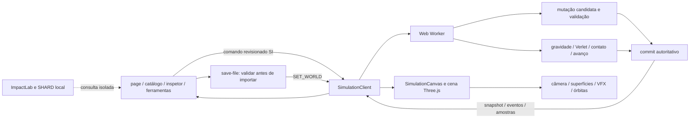

# ASTRO — mapa do sistema e direção de produto

Data: 23/10/2026. Estado: planejamento; nenhuma funcionalidade deste documento foi implementada nesta rodada.

Plano executável associado: [orquestração por entregas](../plans/2026-10-23-astro-sandbox-orchestration.md).

## 1. Objetivo e leitura correta deste mapa

Transformar o ASTRO em uma sandbox espacial visual, divertida e coerente: criar, lançar, aquecer, congelar, colidir, destruir e reconstruir mundos. Universe Sandbox atual é referência de experiência e capacidades. O objetivo não é reproduzir sua marca, interface ou ativos, nem afirmar paridade científica.

A prioridade do usuário é observar acontecimentos impressionantes e controlá-los facilmente. Mais diagramas orbitais, números e menus não substituem esse objetivo. Informações técnicas continuam disponíveis sob demanda; a cena deve demonstrar a consequência da ação.

Este mapa cobre produto, Core, Worker, persistência, renderer, interação, ativos, desempenho e possibilidades futuras. As propostas estão separadas do código existente. Recursos de pesquisa não bloqueiam melhorias visuais independentes.

### Evidências e limites desta revisão

- Checkout lido: `C:/Users/fabio/Desktop/Portifólio/Astro`, branch `astro/web-foundation`, HEAD `3f53bfd522f75e49e295d6fd218e9f35a52d9da4`.
- A maior parte de `src/**`, `docs/**` e ativos aparece como untracked. HEAD não representa a aplicação inteira e não serve como baseline de autoria.
- Foram lidos código e documentos atuais, com revisões paralelas de Core, renderer e UX. Não houve teste, build, lint, typecheck, navegador ou servidor nesta rodada.
- O grafo `graphify-out/graph.json`, de 16/10/2026, foi usado apenas como índice. Não cobre todas as mudanças recentes e não foi atualizado.
- Relatórios Chrome de rodadas anteriores são evidência histórica, não uma nova execução. Não tratar contagens antigas de testes como gates atuais.
- Versões do manifesto do projeto: Next 16.4.1, React 19.3.1, Three.js 0.186.1, Zod 4.6.7, Playwright 1.64.1, Vitest 5.0.5; Node exigido `>=24.21.0 <25`, pnpm 12.11.2. Versões executáveis não foram aferidas aqui.

## 2. Arquitetura implementada

**Regra a preservar:** o Worker decide o estado físico aceito. A cena consome esse estado e efeitos transitórios. UI não converte tipos, não publica corpos otimistas e não recompõe o universo a partir de snapshots possivelmente antigos para aplicar uma ação.

### Mapa de responsabilidades

| Área | Arquivos atuais principais | O que já existe | Limite e direção |
|---|---|---|---|
| Entrada e coordenação | `src/app/page.tsx`, `simulation-world-sync.ts` | Solar inicial, seleção, editor, revisão de mutações, reset/import, ferramentas | Página concentra muitos estados assíncronos. Extrair somente responsabilidades tocadas por novas entregas; evitar reescrita geral. |
| Interface | `ObjectInspector.tsx`, `BodyCatalog.tsx`, `SimulationToolbar.tsx`, `SimulationExperimentsDock.tsx`, `globals.css` | Criar, duplicar, explodir, presets de superfície, campos exatos, Mais, comparação de tamanhos | Tornar ferramentas e consequências descobríveis; evitar controles concorrentes no mobile. |
| Ponte visual | `SimulationCanvas.tsx`, `celestial-scene.ts` | Estado aceito, eventos, safe viewport, callbacks, ciclo RAF | Cena concentra câmera, input e efeitos. Separar controlador apenas quando a próxima feature precisar da fronteira. |
| Domínio e limites | `types.ts`, `world.ts`, `physics.ts`, `physical-constants.ts` | SI, validação, gravidade N-body, limites explícitos | Sem composição interna, spin, atmosfera ou campos locais de superfície. |
| Integração e tempo | `integrator.ts`, `simulation-time.ts`, `integration-sample-buffer.ts` | Velocity-Verlet, passos adaptativos, contatos varridos, amostras aceitas, avanço parcial por orçamento | Não resolve hidrodinâmica. Tempo muito rápido é limitado; erro físico continua rejeição. |
| Colisões | `collisions.ts` | Merge científico e fragmentação criativa de seis corpos com orçamento energético | Não modela erosão parcial, crateras ou material. Fragmentação não é previsão LS12/SHARD. |
| Mutações | `world-mutations.ts`, `body-edits.ts`, `body-catalog.ts`, `binary-star.ts` | CRUD, pose atômica, duplicação, explosão, edição estelar | Expansões devem continuar candidatas atômicas, com rollback e cap. |
| Worker e protocolo | `simulation.worker.ts`, `simulation-client.ts` | Comandos serializados, revisão/ACK/rejeição, eventos e modo criativo | Cada campo novo exige produtor e parser. Não usar `worldRevision` isoladamente como prova de sucesso após ERROR. |
| Persistência | `save-file.ts`, `SaveControls.tsx` | JSON estrito v1–v7, limites, importação local validada; v5 persiste perfil térmico, v6 inventário de água, v7 composição seca explícita | Não salva histórico de eventos, câmera ou checkpoint completo de execução. |
| Estrelas | `stellar-main-sequence.ts`, `stellar-evolution*.ts`, `solar-track-v1.json` | Eker MS e trilha MIST solar 1 M☉, modos manual/secular | Massa atual não é idade nem identidade de track. Sem evolução universal ou supernova física. |
| Órbitas e medidas | `orbital-analysis.ts`, `orbit-paths.ts`, `orbit-trails.ts`, `OrbitalReadout.tsx` | N-body real, guias osculantes, rastros aceitos, binária, referencial orbital | Guia de dois corpos não é previsão N-body. Lagrange é aproximado. |
| Câmera e criação | `camera-focus.ts`, `scene-scale.ts`, `scene-placement.ts` | Voo suave, refoco tolerante, overview assistido, ghost, clique/arrasto | Diferenciar raio físico, envelope visual e alvo de interação. |
| Superfícies | `celestial-bodies.ts`, `body-appearance.ts`, `surface-material.ts`, `surface-phase.ts`, `body-texture.ts`, `thermal-model.ts` | Mapas, oceanos/gelo/vapor visuais, emissão térmica ilustrativa e perfil global opt-in | Sem topografia persistente, fluxo de água, atmosfera ou clima local. |
| Ambiente e efeitos | `celestial-environment.ts`, `scene-events.ts`, `scene-effect-scale.ts`, `black-hole-capture-effect.ts` | Estrelas/fundo, poeira, flare, fogo/gás, detritos, captura BH | Melhorar hierarquia de luz e continuidade; efeitos não devem esconder corpos nem interface. |
| Labels e marcadores | `scene-labels.ts`, `scene-lagrange-points.ts`, `lagrange-points.ts` | Seleção acessível, oclusão, ocultação de detritos, pontos aproximados | Detritos são identificados por IDs transitórios de eventos aceitos; nomes não classificam corpos. Proveniência persistente ainda depende do contrato C1. |
| Ativos | `rock-assets.ts`, `public/models/**`, `public/textures/**` | Esfera UV própria, mapas planetários, Bennu, Poly Haven, fallback procedural | Licença e orçamento por ativo; não baixar modelos pesados sem close-up demonstrar benefício. |
| Laboratório isolado | `impact-outcomes.ts`, `impact-outcome-loader.ts`, `ImpactLab.tsx`, `public/impact-data/**` | Consulta SPH SHARD local | Sem CTA principal e sem inserção live; dados tardios não equivalem ao contato. |
| Qualidade | `*.test.ts`, `e2e/*.spec.ts`, `scripts/verify-quality-rules.mjs`, `docs/quality.md` | Casos numéricos, protocolo, cena e Chrome acumulados | Fonte dos testes prova cobertura pretendida, não passagem atual. Evidência visual precisa timestamp e versão estável. |

## 3. Contratos e fronteiras que o executor precisa conhecer

### Estado físico atual

`CelestialBody` possui ID/nome, kind, bodyType opcional, parentId opcional, massa, raio, posição, velocidade, temperatura, água escalar e metadata MIST opcional. Tipos: estrela comum, WD, NS, BH, rochoso, gigante gasoso, lua, asteroide e cometa.

Não há rotação física, inventário químico, pressão atmosférica, calor específico, estrutura interior, terreno, crateras persistentes ou estado de acreção. Não preencher essas lacunas no renderer e depois descrevê-las como física.

### Comandos existentes úteis

- `CREATE_BODY {bodyType, primaryId, positionM?, velocityMs?}`: pose opcional atômica; com pose é corpo livre, sem parentId; vetor omitido zera. Sem pose mantém criação orbital legada.
- `DUPLICATE_BODY {bodyId, positionM, velocityMs?}`: fonte autoritativa, nova identidade; sem velocidade herda a original; remove parentId e metadata MIST.
- `EDIT_BODY {bodyId, field, value}`, `REMOVE_BODY`, `EXPLODE_BODY {bodyId, specificEnergyJkg?}`, `SET_SETTINGS`.
- `SET_COLLISION_MODE`, `SET_SPEED`, `START`, `PAUSE`, `SET_WORLD`, comandos de evolução solar e amostragem.
- `SET_WORLD` restaura modo científico. Eventos e modo não entram no save atual. Reset deve limpar estado de ferramenta, câmera e revisão sem reaplicar ações antigas.

### Eventos atuais

Tipos `collision`, `explosion`, `black-hole-capture`; campos comuns `id`, `timeSeconds`, `positionM`, `radiusM`, `energyJ`, `bodyIds`. Outcome diferencia merge, fragmentação criativa e acreção criativa. `visualEffect: 'stellar-gas-expansion'` só é válido em explosion, energia zero e um ID.

IDs de fragmentos valem no instante aceito; colisões posteriores do mesmo intervalo podem consumi-los. Consumidores filtram pelo snapshot final. Não exigir presença atual de um corpo para validar um evento histórico transitório.

### Limites atuais relevantes

| Limite | Valor/semântica |
|---|---|
| Corpos físicos | 64; nunca truncar massa para caber |
| Massa ordinária | Até `1e32 kg` |
| Raio ordinário | Até `1e10 m`; perfil solar secular tem exceções explícitas |
| Posição por eixo | Até `6e12 m` |
| Velocidade | Até `1e7 m/s` |
| Temperatura | Até `1e9 K` |
| Aceleração suportada | Até `1e6 m/s²` |
| Orçamento de avanço | 512 subpassos / 100.000 avaliações de pares por intervalo |
| Eventos | Até 16 por snapshot; preservar ordem nos lotes |
| Amostras de integração | Até 128 por lote; estimativa até 512 KiB |
| Importação | Até 10 MiB; validação antes de substituir mundo |
| Escala Three.js | `1e-9` unidade por metro; distância máxima de câmera 300.000 unidades |

Ao esgotar apenas orçamento de passos, o Core aceita o prefixo íntegro, avança seu tempo real aceito, descarta o restante daquele tick e sinaliza `speedLimited`. Erros físicos ou aritméticos continuam rejeitando o intervalo. Não mascarar qualquer erro como desaceleração.

### Significado dos modelos atuais

1. Merge: conserva massa, momento linear e soma de volumes. Energia relativa retirada do movimento não é calor calculado.
2. Fragmentação criativa: seis corpos determinísticos; exige energia relativa acima da ligação homogênea de referência, reserva essa parcela e limita kicks ao restante. Fallback é merge inteiro.
3. Explosão manual não estelar: injeta energia externa e cria seis corpos. Estrela comum recebe somente gás visual e permanece intacta; compactos rejeitam.
4. BH: raio Schwarzschild; classificação geométrica quando candidato estelar tem `R <= Rs`. Não representa evolução nuclear ou colapso relativístico. Captura criativa usa fronteira de jogo separada do horizonte.
5. Massa MS: Eker, `0.179–31 M☉`; massa/R/Teff no mesmo candidato. Não muda fase pela massa.
6. Água: `gameplay-water-retention-v1` reduz inventário ao editar T entre 373,15 e 378,15 K; resfriar não repõe água; edição explícita pode repor. Não é escape atmosférico.
7. MIST: somente trilha solar de 1 M☉. EEP1710 é início de formação/cooling sequence WD, sem cooling posterior.

## 4. O que preservar e o que melhorar

### Preservar

- Solar como primeira cena, sem voo inicial para um astro.
- Seleção abre edição; selecionar o mesmo alvo bem enquadrado não reinicia viagem.
- Criação/duplicação com clique e lançamento por arrasto, Escape/Cancelar, sem publicação otimista.
- Explosão respeita pausa/velocidade escolhidas. Detritos não poluem navegação ou guias orbitais.
- Safe viewport compartilhado com dock/inspetor/navegação/transport; reduced motion e controle por teclado.
- Texturas canônicas também em cópias; sólidos persistentes depois de terminar o VFX.
- Status discreto e acessível; detalhes técnicos sob demanda. Nenhuma chuva de notificações.
- Importação local, sem conta nem transmissão de arquivos.

### Problemas estruturais e oportunidades verificáveis no código

| ID | Observação | Consequência | Entrega responsável |
|---|---|---|---|
| MAP-01 | `PRODUCT.md` ainda diz escala sempre real, edição estelar desacoplada e ausência de disco sem matéria | Contradiz overview assistido, Eker e BH artístico existentes | T00 |
| MAP-02 | `docs/setup.md`/`quality.md` misturam históricos com descrições superadas | Executor pode reimplementar algo pronto ou alegar gates inexistentes | T00 |
| MAP-03 | Um PointLight principal e fill de inspeção na cena | Binárias e explosões não compartilham iluminação espacial consistente | T03 |
| MAP-04 | Temperatura é editada, não integrada por fluxo de energia | Sol mais quente/distância menor não aquece planeta automaticamente | T10 |
| MAP-05 | Água é escalar, sem topografia/inventário de vapor/atmosfera | Inundação, evaporação e condensação não são conservação de material | T11–T13 |
| MAP-06 | Identidade visual/debris depende parcialmente de ID e nome | Rename/import/cópia podem perder a apresentação correta | T02 |
| MAP-07 | Colisão usa esferas e seis fragmentos criativos | Sem impacto local persistente, erosão ou crateras | T05, T13, T18 |
| MAP-08 | Preview de colocação é câmera/plano, sem previsão física confirmada | Usuário descobre limites ou colisão só depois de soltar | T04 |
| MAP-09 | Fundo e VFX são ajustados por parâmetros artísticos sem baseline visual automatizado | Risco de placas de nebulosa, branco estourado e detalhe perdido | T01, T03, T06 |
| MAP-10 | Sem undo transacional ou replay de estado | Erro de edição/destruição obriga reset/import | T08 |
| MAP-11 | Save preserva corpos, não execução completa | Reabrir não reproduz instante, câmera ou experimento | T08, T09 |
| MAP-12 | T12 Core guarda composição seca, atmosfera isotérmica, codec v7 e coupling grey ao T10; UI atmosférica e renderer consomem métricas aceitas | Casca azul é ilustrativa, sem espectro; aceitação de experiência/browser segue aberta; colisão/captura composition-aware aguarda T13 | T12, T13, T16–T18 |
| MAP-13 | MIST é solar; SHARD é endpoint tardio | Não há base para evolução de toda estrela ou fragmentação SPH live universal | T20 |
| MAP-14 | DPR tem teto 2; não existe política unificada de qualidade | Efeitos extras podem elevar overdraw/custo no Iris Xe sem reação previsível | T01 |
| MAP-15 | `mergeCollision` espalha o sobrevivente com metadata MIST e depois altera massa/R/T | Uma fusão manual pode conservar metadata de uma estrela que já não corresponde à trilha | T00 |
| MAP-16 | `createBodyEditCandidate` canonicaliza raio/massa BH, mas deixa T/água seguirem pelo caminho genérico | API permite propriedades incompatíveis mesmo se a UI esconder campos | T00 |
| MAP-17 | Raycast usa apenas `visual.surface`, não anel/disco separado | Clicar no anel Saturno ou disco BH pode não selecionar o que parece clicável | T02 |
| MAP-18 | Efeito tem cap máximo projetado, mas não piso de legibilidade no overview | Impacto pode ficar menor que o próprio corpo visualmente ampliado | T05 |
| MAP-19 | Geometria UV principal depende do GLB; texturas têm fallback, esfera não | Falha de um ativo pode deixar a cena sem corpos | T01 |
| MAP-20 | Perfil de textura é escolhido só na criação; resize não troca mapas | Custo/detalhe não acompanha uso posterior desktop/mobile | T01 |
| MAP-21 | Inspetor limpa draft antes do ACK e não tem pending por campo | Sob latência, valor pode parecer voltar ao anterior; hipótese de experiência a reproduzir | T00 |
| MAP-22 | Labels ativos sem vaga não possuem o mesmo fallback completo do selecionado | Possível posição antiga em cena congestionada; pixel exato precisa Chrome | T02 |
| MAP-23 | Captura BH exclui outro BH e merge rejeita BH | Encontro BH–BH não possui resolução jogável; definir recusa recuperável ou modelo criativo | T07 |
| MAP-24 | Alvos móveis de velocidade/exemplos usam 36/32 px em trechos do CSS | Abaixo do alvo de 44 px do próprio design | T00 |

Estes são limites/fatos de fonte e oportunidades, não uma alegação de que todos foram reproduzidos no navegador nesta revisão.

Âncoras de localização nesta leitura: `collisions.ts:49` (`mergeCollision`), `collisions.ts:80` (herança), `body-edits.ts:31` (`createBodyEditCandidate`), `celestial-scene.ts:836` (GLB), `celestial-scene.ts:858` (picking), `scene-labels.ts:46` (layout), `ObjectInspector.tsx:63` (editor). Linhas são orientativas; símbolos e caminhos prevalecem após novos patches.

### Não reabrir como defeitos atuais sem reprodução

A busca de primário já reconhece companheira de massa igual via relação inversa. Reset/import já desligam referencial orbital. Fluxo recente já trata seleção da cópia após clique, cancelamento de placement, repetição de foco, estado de pausa da explosão e navegação de detritos. Manter como regressões a proteger, não backlog duplicado.

## 5. Matriz de capacidades inspirada no Universe Sandbox

Legenda: **E** existente; **P** parcial/ilustrativo; **N** ausente; **R** pesquisa/modelo necessário. Prioridades são ordem de produto, não datas prometidas.

| Capacidade | ASTRO atual | Próxima decisão concreta | Tarefa |
|---|---|---|---|
| N-body, baricentro, perturbação | E | Preservar; exibir consequências com ferramentas melhores | T04 |
| Pausa, velocidade, ritmo adaptado | E | Feedback curto e sem erro por orçamento | T00/T01 |
| Criar, duplicar, lançar | E/P | Altura/plano, trajetória curta e validação de destino | T04 |
| Criar em órbita/binária | E/P | Modo Órbita visual sem obrigar “ao redor de X” | T15 |
| Colisão e fusão | E | Cena de contato legível e persistência de impacto | T05 |
| Fragmentação física geral | P/R | Modelo criativo declarado; perfil científico só após calibração | T18/T20 |
| Explodir planeta | E | Fogo localizado, iluminação e detritos sólidos legíveis | T05 |
| Supernova com remanescente | N/R | Modelo criativo explícito, não massa-limiar universal | T14 |
| Estrela com granulação/corona | E/P | Exposição, prominências moderadas e sombra/luz coerentes | T03/T06 |
| BH horizonte/disco/captura | E/P | Matéria visível vinculada ao evento; lente aproximada opcional | T07 |
| WD/NS/pulsar | P | Distinguir superfície; pulsar só com spin/eixo e contrato | T06/T16 |
| Água/gelo/vapor | P | Inventário conservado e superfície espacial | T11/T13 |
| Clima por irradiação | N | Balanço térmico global primeiro, mapa depois | T10/T13 |
| Atmosfera e efeito estufa | P/R | Core deriva pressão, escala e óptica; UI/renderer consomem estado/métricas aceitos; `grey-one-layer-back-radiation-v1` acopla q de gás seco + H₂O ao T10. Casca azul ilustrativa, sem espectro; gate de experiência/browser aberto | T12 |
| Composição de materiais | P | Core tem perfis versionados, composição seca, size edit e massa atmosférica opcional; água vem só do inventário T11. UI de size/atmosfera entregue; experiência/browser ainda sem aceite | T12 |
| Terraformar Marte | P | Não só tint: relevo, cobertura, calor e inventário | T11–T13 |
| Crateras e lava persistentes | N | Campo de superfície limitado e impactos locais | T13 |
| Pincel de superfície | N | Água/calor/elevação com raio/intensidade e preview | T19 |
| Laser | N | Feixe com potência e calor autoritativo; emissão visual vinculada | T17 |
| Empurrar/força | N | Impulso vetorial atômico com energia externa explícita | T17 |
| Meteoro/arrasto/cometa | P/N | Atmosfera, ablação e orçamento de massa | T18 |
| Rotação/eixo/estações | P/N | Separar animação decorativa de spin persistente | T16 |
| Roche/marés/travamento/J2 | N/R | Modelos limitados e fixtures, depois visual | T18/T20 |
| Anéis/cinturões dinâmicos | P | Enxame agregado limitado, sem milhares de massas N-body | T15 |
| Planetas procedurais | P | Seed e perfis distintos, cobertura/material coerentes | T06/T12 |
| Galáxias/nebulosas dinâmicas | N | Cena separada com modelo de partículas; não alegar galáxia N-body completa | T23 |
| Fundo natural | P | Céu esférico contínuo e estrelas estáveis | T06 |
| Foco suave/câmera livre | E | Preservar intenção e posição do usuário | T00 |
| Referencial orbital | E/P | Validar pares, zoom, drag, mobile e modo assistido | T00/T01 |
| Pousar/voo rasante | N | Câmera próxima com limites; depende de superfície detalhada | T19 |
| Multi-seleção/edição | N | Seleção + mutação de lote atômica | T21 |
| Operações numéricas rápidas | P | ×2/÷2, unidades claras e entrada validada | T21 |
| Undo/redo | N | Checkpoints bounded e revisão nova | T08 |
| Save/load/compartilhar arquivo | E/P | Checkpoint v4 compatível; miniatura local | T09 |
| Biblioteca de experiências | P | Cartões visuais com cenários completos e restauração | T09 |
| Foto/gravação/som | N | Foto limpa, clipe bounded e áudio opt-in | T22 |
| Overlays de temperatura/material | N | Exibir dados do modelo, nunca pintar sem estado | T13/T19 |
| Gráficos e histórico | P/N | Séries bounded persistem após destruição; secundário | T21 |
| Trajetória futura | N | Clone isolado, horizonte curto, cancelamento por revisão | T04 |
| Lagrange | E/P | Manter rótulo aproximado, fora do caminho inicial | T00 |
| Evolução estelar multi-massa | N/R | Dados/licença/família/idade antes de UI | T20 |
| Hawking/GR detalhada | N/R | Não prioritário; modelo separado se trouxer experiência observável | T23 |
| Vida/ecossistemas | N/R | Fora do núcleo próximo; não simular por vegetação pintada | T23 |
| Workshop/nuvem/contas | N | Não necessário à diversão local; exige escopo próprio | T23 |
| VR/naves/megastruturas | N | Horizonte opcional, não dependência das entregas visuais | T23 |

## 6. Direção visual e experiência pretendida

### Cena

Fundo contínuo, escuro, com poeira quente sutil e concentração orgânica de estrelas. Sem planos retangulares aparentes e sem mover nebulosas junto da câmera. Exposição deve preservar continentes e rochas; flare não é disco branco opaco sobre a cena.

No overview, assistência de tamanho discreta e declarada. No foco, corpo com presença, disco/anel inteiro dentro da área livre e sem zoom automático a cada edição. Grandezas físicas e áreas de colisão permanecem SI. Guias translúcidas na cor do astro; detritos sem órbitas/labels por padrão.

Impacto precisa ter quatro leituras: aproximação, contato, material em movimento e resultado persistente. Luz, cratera/calor e remanescentes devem concordar com o evento aceito. Um anel temporário sozinho não satisfaz a entrega.

### Ferramentas e edição

- Uma ferramenta ativa por vez: Selecionar, Criar/Lançar, Empurrar, Laser, Superfície, Câmera. Ícone acompanhado de nome curto.
- Inspetor mostra primeiro aparência e ações: Água, Temperatura, Tamanho, Massa. Valores avançados recolhidos.
- Edição enquanto o mundo roda tem ACK legível e não luta com o cursor. Preview é distinto do estado aceito.
- Seleção simples não interrompe a câmera se o alvo já está enquadrado. Voo só quando muda o alvo ou há pedido explícito de foco.
- Mobile tem uma área de cena contínua utilizável; painel não vira a aplicação inteira. Fechar/voltar e reset sempre alcançáveis.
- Mensagens explicam recuperação em uma frase; detalhes científicos não viram notificação recorrente.

### Experimentos que deverão funcionar de ponta a ponta

1. Lançar Marte na Terra: preview, impacto, luz localizada, destroços e remanescente persistente.
2. Chuva de meteoros: enxame limitado, trajetórias, entrada atmosférica e trilhas.
3. Terra seca, oceânica e congelada: cobertura espacial diferente e inventário persistido.
4. Aproximar Terra do Sol: aquecimento gradual visível, sem editar temperatura manualmente.
5. Laser no lado noturno: ponto aquece, brilha e deixa marca; energia externa registrada.
6. Empurrar Lua: impulso altera trajetória e resultado é previsível no preview curto.
7. Supernova criativa: estrela muda para remanescente segundo perfil explícito, gás separado de rochas e luz transitória nos vizinhos.
8. BH engole matéria: aproximação, captura aceita e vórtice/disco transitório sem chamar zona de jogo de horizonte.
9. Duas estrelas: ambos os lados iluminam corpos, referencial orbital legível e criação de planeta ao redor do conjunto.
10. Construir anéis: distribuir material sem ultrapassar cap nem descartar massa silenciosamente.
11. Congelar e aquecer Marte: gelo/água/vapor e atmosfera respondem ao mesmo estado.
12. Foto e replay de impacto: ocultar UI, capturar, restaurar checkpoint e repetir sem evento fantasma.

## 7. Desempenho, dados e ativos

O alvo inicial continua Chrome/Windows com i5-1235U/Iris Xe. Relatórios RAF anteriores são provisórios e medem cadência, não tempo de GPU. A execução futura deve medir novamente após efeitos integrados.

Priorizar instancing, geometria compartilhada, partículas bounded, textura com mipmaps, overdraw controlado, render scale adaptativo e qualidade baixa disponível. Evitar pós-processamento pesado por padrão; bloom seletivo só se couber no orçamento medido. Não elevar cap64 ou adotar outro solver antes de medir gargalo real.

Solar System Scope/INOVE tem atribuição CC BY 4.0; Poly Haven Rock Ground é CC0; Bennu tem crédito NASA VTAD e diretrizes NASA. Usar ativos existentes primeiro. Registrar URL, licença, tamanho, hash, transformação e fallback para qualquer novo recurso. Não incorporar modelos de terceiros só porque estão publicamente acessíveis.

v4 separa mundo e sessão; novas extensões persistentes ganham versão compatível, como o perfil térmico v5. v1–v4 permanecem legíveis e não recebem perfis silenciosamente. Eventos/VFX continuam transitórios. Superfície detalhada precisa teto explícito e formato que respeite limite de importação; não colocar texturas enormes em JSON sem projeto de armazenamento.

## 8. Bloqueios de pesquisa e decisões já resolvidas para o plano

- **SHARD live continua bloqueado:** rotação/translação do frame não inverte ~10 h de evolução SPH. Usar apenas lab; nenhuma task visual depende de liberar esse gate.
- **LS12/Crespi não determinam um universo completo de fragmentos:** não vender uma amostra seeded como solução física única. Modelo criativo pode avançar com nome, domínio e contabilidade próprios.
- **Evolução multi-massa:** pesquisar licença, tracks/famílias, idade comum válida e limites. 10 M☉ terminar em C-burning não autoriza inventar NS/BH terminal.
- **Supernova:** recomendar ação criativa separada do gás estelar já existente. Produto pode ter espetáculo sem afirmar evolução nuclear completa.
- **Água:** manter regra atual até existir inventário/modelo substituto; não acumular duas perdas independentes na mesma edição.
- **Porta principal:** não remover aplicação da 3000 sem identificar checkout/processo. Planejar URL canônica do ASTRO; preservar outro projeto até atribuição inequívoca. Trocar porta não é feature visual.

## 9. Fontes oficiais e uso da referência

Consulta em 23/10/2026. Fontes servem para capacidades e direção, não para copiar implementação.

- [Universe Sandbox — produto](https://universesandbox.com/): referência geral de criação, gravidade, colisões e experimentação visual.
- [Update 35 — Space in a New Light](https://universesandbox.com/blog/2025/03/space-in-a-new-light-update-35/): iluminação e interface dinâmica como inspiração de apresentação.
- [Update 36 — Pale Blue DOTS](https://universesandbox.com/blog/2026/03/pale-blue-dots-update-36/): exemplos de laser, meteoros, rotação/marés e previsão; não transferir arquitetura Unity/DOTS para a aplicação web.
- [Update 36.3 — Crashing Craters](https://universesandbox.com/blog/2026/08/crashing-craters-update-36-3/): referência de crateras combinadas, duplicação, hologramas e continuidade dos gráficos.
- [Roadmap 2026](https://universesandbox.com/blog/2026/03/universe-sandbox-roadmap-2026/): distinguir recursos publicados de pesquisas e planos; não tratar ciclo nuclear completo, vida e naves como paridade obrigatória imediata.
- [FAQ oficial](https://universesandbox.com/faq/): distinguir Universe Sandbox atual do produto Legacy.
- [Press kit](https://universesandbox.com/presskit/): consulta visual; disponibilidade não concede automaticamente direito de usar ativos no ASTRO.

Os vídeos indicados pelo usuário são referências adicionais para o executor assistir; esta rodada não afirma reprodução ou análise quadro a quadro deles.

## 10. Definição de sucesso

O usuário deve conseguir descobrir e executar três experimentos chamativos sem ler um manual: lançar um impacto, transformar a superfície de um planeta e provocar um evento estelar criativo. Cada ação deve produzir consequência persistente coerente, continuar jogável depois do efeito e poder ser reiniciada ou desfeita.

Paridade total com Universe Sandbox não é uma entrega única verificável. O plano associado divide essa ambição em fatias completas, com contratos, demonstrações e limites. Não anunciar nenhuma delas como entregue antes da integração e da experiência real no Chrome.
